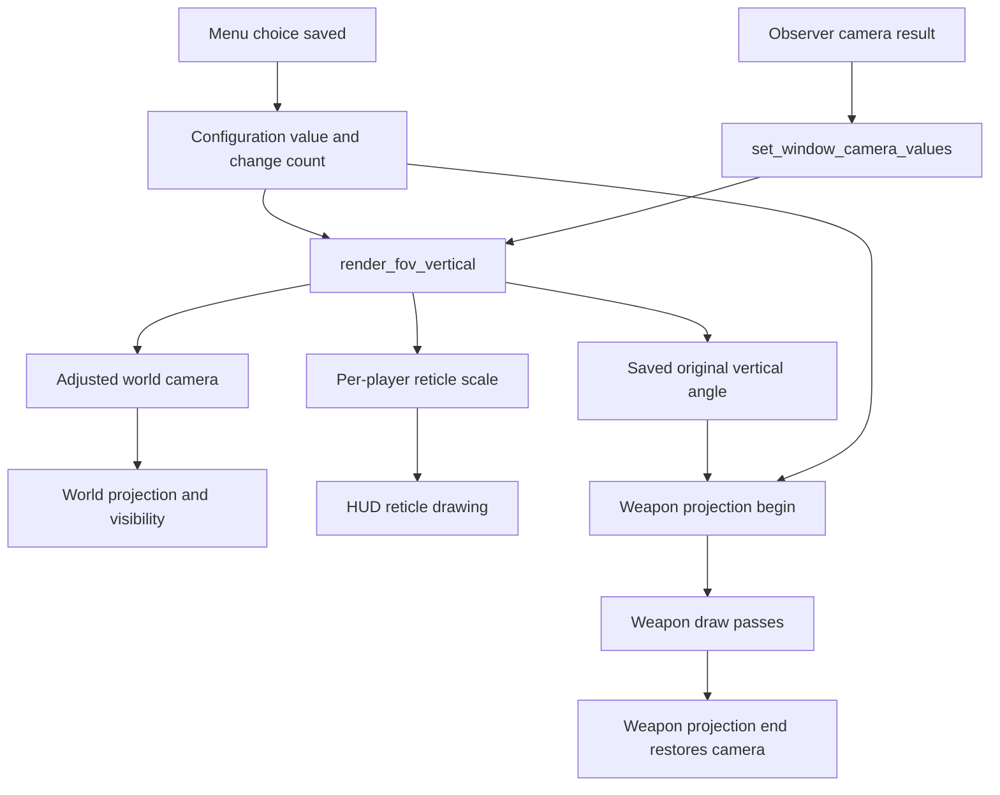

# Following a field-of-view setting

This walkthrough follows GulchCE's existing first-person FOV feature from
a menu choice to the picture you see. It explains the implementation, not
a change to it. Keep the [glossary](glossary.md) nearby for unfamiliar terms;
the [reader's guide](README.md) explains the repository's structure.

## What you see

Video Setup's FOV AND VIEWMODELS screen has separate settings for the world
and the weapon and hands. Widening the world lets you see more around you.
By default, the weapon keeps its existing projection so that nearby arms
and a gun do not stretch along with the world. The aiming reticle adjusts
to the world view.

Both angle settings default to `0`, meaning stock. The menu offers DEFAULT
and 80 through 150 degrees in steps of 5; the configuration accepts 20
through 150. These are horizontal angles at 16:9. Other window shapes keep
the same vertical angle. The player-facing reference is
[Field of view](../../port/linux/README.md#field-of-view).

The example below assumes a living local player on foot, in first person,
outside a cinematic or scripted camera, with an ordinary unzoomed view
narrower than the requested 120 degrees.

## Open these files in order

| Step | File and names to find | What to look for |
| --- | --- | --- |
| 1 | [port_config.c](../../port/linux/src/port_config.c): `config_settings`, `display.fov`, `config_write`, `config_changes` | The setting's default and the way readers notice a change. |
| 2 | [port_settings.py](../../tools/port_settings.py): `SCREENS["video_settings/fov_viewmodels"]`; [menu_functions.c](../../port/linux/game/menu_functions.c): `setting_changed_save`, `setting_write` | How a menu choice becomes a configuration value. |
| 3 | [main.c](../../source/main/main.c): `set_window_camera_values` | The point where an observer result becomes a local render camera. |
| 4 | [view_fov.h](../../port/linux/game/view_fov.h), then [view_fov.c](../../port/linux/game/view_fov.c): `render_fov_vertical`, `render_fov_adjust` | The feature's interface, guards, angle conversion and zoom behaviour. |
| 5 | [hud_draw.c](../../source/interface/hud_draw.c): `hud_draw_bitmap_with_meter`, `hud_draw_bitmap_internal` | Where the stored reticle scale affects the drawing. |
| 6 | [view_fov.c](../../port/linux/game/view_fov.c): `viewmodel_projection_begin`, `viewmodel_projection_end`; [rasterizer_xbox_models.c](../../source/rasterizer/xbox/rasterizer_xbox_models.c): `_rasterizer_model_begin`, `_rasterizer_model_end` | A temporary weapon camera and one pair of callers that restores it. |

The flow below shows dependencies. The menu saves a setting once; rendering
reads the current setting as views are drawn. These are not all calls in a
single stack.



## 1. A menu choice becomes a value

In `config_settings`, `display.fov` is a real-valued setting with default
`0.0` and environment variable `HALO_FOV`. `display.viewmodel_fov` has its
own default and environment variable. The nearby strings become explanatory
comments in `config.toml`.

The menu generator associates its FOV row with the same setting name.
When the user saves a changed selection, `setting_changed_save` passes its
text value to `setting_write`. For this non-profile setting, that delegates
to `config_write`, which updates the in-memory value, attempts to save it
to `config.toml`, and advances `config_change_count`. Its return value
reports whether the file write succeeded; updating memory and persisting
the file are distinct steps.

`render_fov_adjust` caches the converted setting in `requested_tangent`.
It reads the configuration on its first call and whenever `config_changes()`
differs from its saved `read_at`. It does not repeat the setting conversion
for every view. This count covers configuration changes generally, not just
FOV. The menu XML is generated output; the generator is the place to change
the choices.

## 2. Change the render camera at its boundary

`set_window_camera_values` receives a window and a read-only observer
result. It copies camera position and orientation and computes the native
vertical FOV. It then uses `render_fov_vertical` to choose the angle for
the local render camera. The observer's result is not rewritten by this
FOV adjustment.

The input angle is already part of the game's camera convention.
`render_camera_get_adjusted_field_of_view_tangent` in
[render_cameras.c](../../source/render/render_cameras.c) multiplies the
half-angle tangent by `0.85`; the conversion in `main.c` also applies
`0.75`. Follow those expressions when tracing a stock angle rather than
assuming a number from a unit tag is the final on-screen angle.

Later, [render.c](../../source/render/render.c) builds frustums from the
prepared cameras. Applying the FOV before that step makes the projected
picture and the visibility calculations use the chosen angle together.
Changing only the final picture could leave objects outside the old view
excluded from drawing.

On `online-third-person`, `set_window_camera_values` first lets
`third_person_camera` resolve the shoulder camera and collision, then
chooses the FOV. Its `render_fov_vertical` keeps the native angle while
`third_person_active` is true, and `viewmodel_is_visible` also hides the
first-person weapon in that mode. The first-person path described here
applies when that mode is inactive. This branch-specific ordering matters
when locating the call in `main.c`.

## 3. Read the reasons for doing nothing

Inside `render_fov_adjust`, several early returns preserve the incoming
angle. The adjustment needs a valid requested angle and local-player
index, a suitable first-person director state, and a live unit. It is
bypassed during cinematics, scripted cameras or inhibited camera facing,
and for a unit attached to a parent object or marked dead. The parent
check covers the usual vehicle case. Invalid native or unit-definition
angles also leave the view unchanged.

`unit_index` is a datum handle, not a direct subscript. The function checks
for `NONE`, asks `unit_try_and_get` for the unit, and checks the returned
pointer before reading it. These guards explain the feature's scope as
well as avoiding invalid accesses.

## 4. Follow 120 degrees through the calculation

The setting describes a horizontal angle, but the renderer needs a vertical
one. The code first calculates:

```c
tan(degrees * _pi / 360.0) * (9.0 / 16.0)
```

`degrees * pi / 180` would convert degrees to radians. The divisor is 360
here because the calculation uses half the angle. Imagine a triangle from
the eye to the centre and top edge of the view: the tangent of the vertical
half-angle is its half-height divided by distance. Multiplying the
horizontal half-angle tangent by `9/16` converts half-width to half-height
at the reference aspect ratio.

At 120 degrees, `requested_tangent` is approximately `0.9743`. Converting
back with `2 * atan(requested_tangent)` gives about `88.5` vertical degrees.
These are illustrative rounded values, not an exact floating-point test
or a claim about every map's stock camera.

For the unzoomed example, `blend` is one and `native_tangent` equals the
unzoomed reference. This expression therefore reaches the requested tangent:

```c
adjusted_tangent = native_tangent + (requested_tangent - unzoomed_tangent) * blend;
```

The function returns `2.0f * atanf(adjusted_tangent)`, the vertical angle
in radians. The calling code can now build the view from it.

## 5. Zoom changes the calculation

For a request wider than the stock unzoomed view, the extra width fades
away as the weapon zooms. `weapon_get_field_of_view` supplies the weapon's
scoped reference; the blend measures where the current camera lies between
the scoped and unzoomed tangents, clamped to zero through one with `PIN`.
At or beyond the scoped threshold, the function returns the native angle.

The `1.000001f` tolerance at that threshold handles the small rounding
difference described by the code comment: converting through arctangent
and tangent can land slightly above the scoped value. Returning the input
also avoids recalculating an angle that should stay unchanged.

A request narrower than the stock view takes a separate branch. It scales
the native tangent by `requested_tangent / unzoomed_tangent`, narrowing
the zoom too. "Scopes keep their stock view" therefore describes the
widening case, not every possible setting.

## 6. Keep the reticle and weapon consistent

`render_fov_vertical` also writes two arrays indexed by local player:

| State | Written value | Reader |
| --- | --- | --- |
| `reticle_scales` | Native half-angle tangent divided by adjusted half-angle tangent, or one when unchanged or unusable. | `render_fov_reticle_scale`, used by HUD drawing. |
| `authored_vertical` | The incoming vertical angle when the adjustment changes it, otherwise zero. | `render_fov_authored_vertical`, used as the default weapon angle. |

For a widened view, the scale is below one. In `hud_draw_bitmap_with_meter`,
only crosshair bitmaps anchored at the centre receive this scale.
`hud_draw_bitmap_internal` scales their vertices about the view's centre,
including the offsets of separate pieces. It does not scale the entire
HUD. [hud_weapon.c](../../source/interface/hud_weapon.c) distinguishes
scope overlays from the reticle drawing that receives this adjustment.

The weapon can use `display.viewmodel_fov` explicitly. With that setting
at zero, `viewmodel_projection_begin` falls back to the saved incoming
angle when the world FOV changed. Despite the comments' emphasis on
widening, the assignment to `authored_vertical` uses `adjusted != native`:
it records the original for a narrowing adjustment too.

The begin function checks whether a suitable primary first-person view is
being drawn, saves both the render and rasterizer cameras and frustums,
changes their angles, and rebuilds the frustums using their saved bounds.
Those bounds preserve the crop of a split-screen view. The weapon's pose
and attachment markers are not moved by this projection change.

Several weapon passes can nest. `projection_depth` counts unmatched begin
calls: only the outermost begin saves and applies a camera, and only its
matching final end restores it. Even a begin that skips the adjustment has
increased the depth and needs an end. `projection_applied` distinguishes
"entered the scope" from "actually replaced the camera".

These saved structures are shared drawing state, not per-player arrays.
The contract is balanced, nested use within the current render view;
the helper does not provide independent state for concurrent render calls.
Restoring the camera prevents the temporary weapon projection affecting
later drawing. The model begin/end functions are one example; lighting,
transparent geometry and sprite rendering also bracket weapon passes.

## What is inherited and what the port adds

The observer and director, unit and weapon definitions, weapon zoom and
render-camera machinery belong to the existing engine. The port's FOV
module adds the configuration-driven render adjustment, reticle scaling
and temporary weapon projection. Its integration points in `source/`
carry `port:` comments. GulchCE's third-person branch adds the extra
camera selection described above.

The module's opening comment explicitly states that the observer,
transitions and network data retain the game's own camera. The traced
code supports that separation by modifying render state. This is an
explanation of the implementation and its documented intent, not a new
claim based on a multiplayer run.

## Checks and limits

This walkthrough was checked against the configuration, menu save path,
camera calls, FOV module and drawing consumers. No game session was run
to write it. The 120-degree example explains the calculation, not visual
behaviour on a particular map or platform.

The existing [harness](../../tools/harness/README.md) tests include FOV
cases for [first-person legs](../../tools/harness/tests/test_first_person_legs.py)
and [arm shield geometry](../../tools/harness/tests/test_viewmodel_shield.py).
Those exercise their own features; they do not establish coverage of
`render_fov_adjust` or the full projection begin/end lifecycle.

On `online-third-person`, `tools/test_third_person.py` adds
`test_real_fov_restoration`, which extracts the real `render_fov_adjust`
and `render_fov_vertical` functions into a fake world. It checks selected
angles, scoped behaviour, restoration after third person and separation
between local players. `test_perspective_paths` also checks the wrapper's
third-person bypass, with the adjustment helper stubbed. These tests were
inspected, not run, for this guide. No dedicated test of the FOV functions
was found on `main`, `testing`, `dynamic-lighting-test` or `vulkan-renderer`.
These third-person tests do not cover the full projection begin/end lifecycle.

When changing this feature, useful checks would cover the stock sentinel,
angle boundaries, excluded camera states, widening and narrowing through
zoom, separate local-player values, and balanced nested projection calls.
A visual check should compare DEFAULT and a wide angle, zoom transitions,
reticle alignment, default and explicit weapon FOV, and split screen at
different aspect ratios. Third-person builds also need the transition into
and out of that camera checked. These are suggested checks, not recorded
test results; platform requirements still come from [AGENTS.md](../../AGENTS.md).
