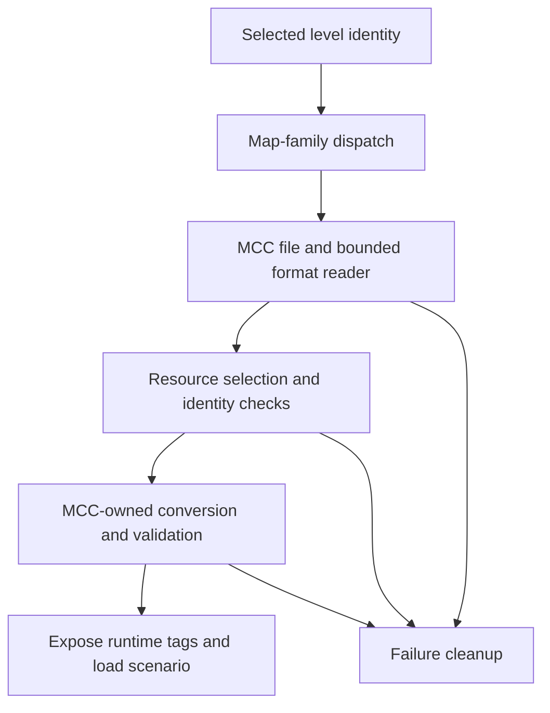

# From a map name to loaded resources

Selecting a map identifies content; it does not yet create a running world.
This chapter follows the loading boundary, using an MCC package level as
the concrete example while keeping the Xbox and Custom Edition paths distinct.
Read [startup](startup_and_loop.md) for the caller and the [glossary](glossary.md)
for tags, BSPs, resources and relocation.

## Reading route

| Order | Source and names to find | What to follow |
| --- | --- | --- |
| 1 | [game.c](../../source/game/game.c): `game_load`; [scenario.c](../../source/scenario/scenario.c): `scenario_load`, `scenario_unload` | A game option becoming a scenario and world. |
| 2 | [cache_files.c](../../source/cache/cache_files.c): `scenario_tags_load`, `scenario_tags_unload` | Dispatch to the selected map family's loader. |
| 3 | [custom_edition_cache.c](../../port/linux/game/custom_edition_cache.c), [cache_file_formats.c](../../port/linux/game/cache_file_formats.c) | CE runtime integration and bounded file parsing. |
| 4 | [mcc_maps.c](../../port/linux/game/mcc_maps.c), [mcc_package.c](../../port/linux/game/mcc_package.c) | MCC discovery, names and package paths. |
| 5 | [mcc_cache.c](../../port/linux/game/mcc_cache.c): `mcc_cache_tags_load`, `mcc_cache_tags_unload`; [mcc_cache_format.c](../../port/linux/game/mcc_cache_format.c) | MCC I/O, conversion lifetime and format validation. |
| 6 | [mcc_resources.c](../../port/linux/game/mcc_resources.c), [mcc_identity.c](../../port/linux/game/mcc_identity.c) | Required resources and admitted content identity. |

## Namespaces select different implementations

| Family | Example identity | Data location and implementation |
| --- | --- | --- |
| Xbox | `levels\a10\a10` | Xbox data in `maps`; the engine's cache path. |
| Custom Edition | `custom_maps\example` | CE data in `custom_maps`; the separate CE parser and conversion path. |
| MCC | `mcc_maps\solar_flare\m0` | MCC data in `mcc_maps`, optionally within a package; MCC-owned readers, conversion and resources. |

These names prevent an MCC level whose internal scenario name resembles
Xbox A10 from replacing that Xbox level. `scenario_tags_load` checks the
requested namespace and returns through the selected loader's path. A
failed CE or MCC load is not an invitation to try a stock map with the
same basename.

The CE reader is standalone C with fixed-width types and bounds-checked
little-endian reads. The host reporting tool and tests use the same parser
as the game. MCC has its own parser and conversion modules; a shared runtime
tag shape does not imply a shared on-disk format or resource owner.

## Follow an MCC package level

Consider selecting `mcc_maps\solar_flare\m0`. This is an illustrative
installed package identity, not a map loaded during this documentation work.
The catalog and package code retain the package path and filename. Map
category comes from checked content rather than an assumption that a
particular filename must be campaign or multiplayer.

`game_load` reaches `scenario_load`, which calls `scenario_tags_load`.
The MCC branch calls `mcc_cache_tags_load`. That loader first unloads any
previous MCC cache state, resolves the local package binding and opens the
source for reading. It reads and validates the tag data through the MCC
format layer before exposing converted data to the engine.

The next steps select required resources, check their checksum and admitted
identity, reserve MCC tag storage, preserve the canonical scenario identity
for saved games, and prepare tags, scripts, geometry, audio and bitmaps.
Converted tags must pass validation. Only after successful preparation does
the loader mark the MCC cache loaded and begin campaign state.

This is a summary of stages, not the complete list of operations or failure
sites. The `problem` string and `failed` label in `mcc_cache_tags_load` make
the exact failure path especially readable.

## Resources are dependencies, not interchangeable files

A level can contain its own data or reference external bitmaps and sounds.
For MCC, a package-local resource takes priority, followed by an explicit
legacy resource at the MCC root. Where neither exists, compatible installed
shared sets are considered. Selection is independent for each resource type.

An explicit but damaged override fails; it is not silently replaced with
another package's data. Required references must match a complete resource
file; partial matches are not assembled from several files. Multiple
different complete matches require the intended resource to be made
unambiguous. Self-contained levels need no external resource selection.
See [MCC maps](../mcc_maps.md) for the exact installation and matching rules.

No MCC resource lookup should wander into Xbox `maps` or CE `custom_maps`.
Likewise, the availability of a resource file called `bitmaps.map` says
nothing by itself about its format or suitability. Network content identity
must account for the map and required resources, not just a convenient
folder name. Peers can bind equivalent MCC content under different local
package names.

## Loading and unloading must agree about ownership

The MCC runtime owns its source stream, tag window, converted geometry,
audio, bitmap resources and associated state. `mcc_cache_tags_unload`
clears precache and feature state, disposes dependent resources, releases
tag storage, closes the stream and clears the runtime structure. The load
failure path frees its temporary raw buffer and calls the same unload path.

In `scenario_tags_load`, the shared engine installs the returned tag table
only after a loader succeeds and performs the relevant menu/HUD/mod wiring.
Additional integration can still fail and require teardown. Thus "the
format parser succeeded" is earlier than "the map is ready to play".

BSP loading is another lifecycle within a scenario. A campaign can switch
its active spatial region without choosing a new menu map. BSP-dependent
geometry and collision must be ready before simulation or network corrections
place players there. [Networking](networking.md) explains why that transition
also needs agreement between host and clients.

## Evidence and compatibility limits

The Xbox cache/scenario machinery is inherited. CE conversion is a port
addition, documented in [Custom Edition caches](../custom_edition_caches.md).
MCC conversion, package identity and its compatibility boundaries are
GulchCE additions. OpenSauce requirements remain unsupported in the CE path;
the presence of an extra header alone is different from requiring its features.

[test_cache_file_formats.py](../../tools/test_cache_file_formats.py) checks
valid and malformed CE inputs, resource dependencies and conversion cases.
[test_mcc_cache_format.py](../../tools/test_mcc_cache_format.py) checks the
independent MCC reader, including invalid ranges.
[test_mcc_checkpoint.py](../../tools/test_mcc_checkpoint.py) addresses another
boundary: saved state and native hooks. These were inspected, not run here.

Use [supported MCC maps](../supported_mcc_maps.md) for recorded compatibility
evidence. Recognition, conversion, loading, reaching gameplay, crossing a
BSP boundary and finishing a campaign are separate claims. A new loader
change needs malformed inputs, failed-load cleanup and Xbox/CE/MCC transitions
checked as well as a successful load of its target map.

Continue with [platforms and testing](platforms_and_testing.md), or return
to the [guide](README.md).
