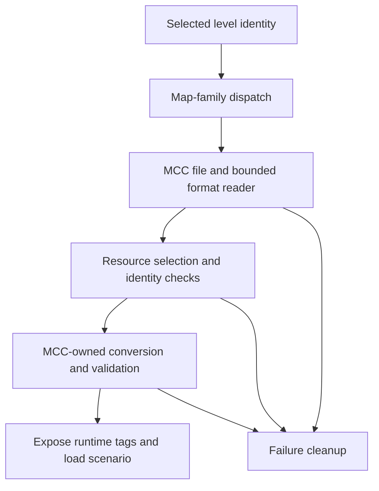

# From a map name to loaded resources

Selecting a map identifies content; it does not yet create a running world.
This chapter follows the loading boundary, using an MCC package level as
the concrete example while keeping the Xbox and Custom Edition paths distinct.
Read [startup](startup_and_loop.md) for the caller and the [glossary](glossary.md)
for tags, BSPs, resources and relocation.

## Reading route

| Order | Source and names to find | What to follow |
| --- | --- | --- |
| 1 | [game.c](../../source/game/game.c): `game_load`; [scenario.c](../../source/scenario/scenario.c): `scenario_load`, `scenario_unload` | A game option becoming a scenario and world. |
| 2 | [cache_files.c](../../source/cache/cache_files.c): `scenario_tags_load`, `scenario_tags_unload` | Dispatch to the selected map family's loader. |
| 3 | [custom_edition_cache.c](../../port/linux/game/custom_edition_cache.c), [cache_file_formats.c](../../port/linux/game/cache_file_formats.c) | CE runtime integration and bounded file parsing. |
| 4 | [mcc_maps.c](../../port/linux/game/mcc_maps.c), [mcc_package.c](../../port/linux/game/mcc_package.c) | MCC discovery, names and package paths. |
| 5 | [mcc_cache.c](../../port/linux/game/mcc_cache.c): `mcc_cache_tags_load`, `mcc_cache_tags_unload`; [mcc_cache_format.c](../../port/linux/game/mcc_cache_format.c) | MCC I/O, conversion lifetime and format validation. |
| 6 | [mcc_resources.c](../../port/linux/game/mcc_resources.c), [mcc_identity.c](../../port/linux/game/mcc_identity.c) | Required resources and admitted content identity. |

## Namespaces select different implementations

| Family | Example identity | Data location and implementation |
| --- | --- | --- |
| Xbox | `levels\a10\a10` | Xbox data in `maps`; the engine's cache path. |
| Custom Edition | `custom_maps\example` | CE data in `custom_maps`; the separate CE parser and conversion path. |
| MCC | `mcc_maps\solar_flare\m0` | MCC data in `mcc_maps`, optionally within a package; MCC-owned readers, conversion and resources. |

These names prevent an MCC level whose internal scenario name resembles
Xbox A10 from replacing that Xbox level. `scenario_tags_load` checks the
requested namespace and returns through the selected loader's path. A
failed CE or MCC load is not an invitation to try a stock map with the
same basename.

The CE reader is standalone C with fixed-width types and bounds-checked
little-endian reads. The host reporting tool and tests use the same parser
as the game. MCC has its own parser and conversion modules; a shared runtime
tag shape does not imply a shared on-disk format or resource owner.

## Follow an MCC package level

Consider selecting `mcc_maps\solar_flare\m0`. This is an illustrative
installed package identity, not a map loaded during this documentation work.
The catalog and package code retain the package path and filename. Map
category comes from checked content rather than an assumption that a
particular filename must be campaign or multiplayer.

`game_load` reaches `scenario_load`, which calls `scenario_tags_load`.
The MCC branch calls `mcc_cache_tags_load`. That loader first unloads any
previous MCC cache state, resolves the local package binding and opens the
source for reading. It reads and validates the tag data through the MCC
format layer before exposing converted data to the engine.

The next steps select required resources, check their checksum and admitted
identity, reserve MCC tag storage, preserve the canonical scenario identity
for saved games, and prepare tags, scripts, geometry, audio and bitmaps.
Converted tags must pass validation. Only after successful preparation does
the loader mark the MCC cache loaded and begin campaign state.

This is a summary of stages, not the complete list of operations or failure
sites. The `problem` string and `failed` label in `mcc_cache_tags_load` make
the exact failure path especially readable.

## MCC loading feedback

[mcc_loading.c](../../port/linux/game/mcc_loading.c) owns a local progress
session around `game_load`'s `scenario_load` call. This small shared hook is
needed because successful tag conversion is followed by menu integration and
initial BSP setup; completing the screen inside `mcc_cache_tags_load` would
report success too early. Non-MCC loads, headless runs and an already-owned
native progress screen do not start an MCC session. Every normal success or
failure return closes only the session it started.

`mcc_cache_tags_load` advances the stage after resources, tags, scripts,
geometry, audio, textures and validation. Converter loops report completed
items; bounded inner audio/texture and resource-read steps call
`mcc_loading_pulse` to refresh even while one item is still in progress.
Stage weights describe work, not seconds remaining. Progress never goes
backward, and only a successful scenario load reports completion.

Drawing uses the inherited `progress_bar_begin`, `progress_bar_display` and
`progress_bar_end` interface and direct device presentation. It deliberately
does not render normal game frames, widgets or run the game/network loop:
those paths can access partially converted tags. Presentation pumps existing
platform window events. Refreshes are separated by at least 50 milliseconds;
blocking file reads, allocation and individual codec operations can still
pause the animation. The normal renderer installs its viewport on return.

The effect uses the installation's `maps/loading.tga`, imported by OpenCE from
the Xbox disc image; MCC packages do not supply or replace it. Missing art has
the existing loading renderer's black-texture behavior. Catalog browsing reads
only headers and descriptions. Uncached menu admission and content-fingerprint
probes also use this feedback while checking resources: `mcc_resources_inspect`
ends only a progress session it started, preserving an enclosing map load.
No new network message or readiness decision is introduced: peers still finish
their own conversions and use the existing host-controlled loading protocol.

`mcc_cache_probe` in [mcc_cache.c](../../port/linux/game/mcc_cache.c) retains
one successful package checksum so selection, local admission and lobby
readiness do not repeatedly read gigabytes of unchanged resources. Its
[mcc_precache_snapshot](../../port/linux/game/mcc_precache.c) includes the map,
package and root overrides, and both shared resource sets, even absent files.
A different name or changed metadata requires validation again; failed metadata
queries prevent reuse, and changes during validation refuse the result. Catalog
rescans can retain this checksum because every use checks those inputs again.
Unload and disconnect clear it. The SHA-256 admission check remains separate,
and actual loading still checksums and fingerprints the opened content.
This bounds retained state to one name, nine file stamps and a checksum; it is
not a persistent cache or proof against edits that preserve all recorded metadata.
The first check still takes time, with loading feedback instead of a frozen menu.
Admission explanations pass through this same cache: a successful reuse clears
stale caller text, while a failed fresh check returns its resource explanation.
An install changing during validation gets its own refusal message.
[test_mcc_validation.py](../../tools/test_mcc_validation.py) exercises reuse,
changed inputs, failed validation, identity checks and checksum disagreement.

[test_mcc_loading.py](../../tools/test_mcc_loading.py) exercises the controller's
ownership, stage ordering, rate limit, timer wrap, re-entry, failed device
queries and cleanup. Converter tools use a headless display stub while retaining
their real conversion and validation code. Runtime checks must additionally
cover visible output, failed/repeated loads, co-op and Xbox/CE transitions.

## Resources are dependencies, not interchangeable files

A level can contain its own data or reference external bitmaps and sounds.
For MCC, a package-local resource takes priority, followed by an explicit
legacy resource at the MCC root. Where neither exists, compatible installed
shared sets are considered. Selection is independent for each resource type.

An explicit but damaged override fails; it is not silently replaced with
another package's data. Required references must match a complete resource
file; partial matches are not assembled from several files. Multiple
different complete matches require the intended resource to be made
unambiguous. Self-contained levels need no external resource selection.
See [MCC maps](../mcc_maps.md) for the exact installation and matching rules.

No MCC resource lookup should wander into Xbox `maps` or CE `custom_maps`.
Likewise, the availability of a resource file called `bitmaps.map` says
nothing by itself about its format or suitability. Network content identity
must account for the map and required resources, not just a convenient
folder name. Peers can bind equivalent MCC content under different local
package names.

When MCC is selected at host creation, `mcc_cache_checksum` in
[mcc_cache.c](../../port/linux/game/mcc_cache.c) also calls
`mcc_identity_prepare_host` in [mcc_identity.c](../../port/linux/game/mcc_identity.c)
before the lobby opens. Fast network setup can
instead open a temporary lobby and request MCC while its local client is
still joining. `mcc_ui_network_defer_map` in
[mcc_ui_network.inl](../../port/linux/game/mcc_ui_network.inl) retains that selection until local
admission completes; `mcc_ui_network_update_map` then applies it through the
ordinary map-change function. A pending selection prevents starting the
temporary map, and legacy selections or teardown cancel it. These paths keep
package work outside the local client's five-second joining state.
`mcc_identity_host_settings` reuses that digest only while the map and all
resource-candidate file stamps match, including absent overrides. Changed
files require fresh validation; disconnect clears the cache. Local admission
also reuses the prepared hash when its canonical path, complete snapshot and
all digest bytes match, avoiding another scan of the host's unchanged package
while remote clients wait. Other machines compute their own fingerprints;
actual loading always rehashes the opened content. This timing change is
MCC-owned and changes neither Xbox/CE paths nor network timeouts or packet
formats. It does not eliminate arbitrary storage or main-thread stalls.

## Loading and unloading must agree about ownership

The MCC runtime owns its source stream, tag window, converted geometry,
audio, bitmap resources and associated state. `mcc_cache_tags_unload`
clears precache and feature state, disposes dependent resources, releases
tag storage, closes the stream and clears the runtime structure. The load
failure path frees its temporary raw buffer and calls the same unload path.

In `scenario_tags_load`, the shared engine installs the returned tag table
only after a loader succeeds and performs the relevant menu/HUD/mod wiring.
Additional integration can still fail and require teardown. Thus "the
format parser succeeded" is earlier than "the map is ready to play".

BSP loading is another lifecycle within a scenario. A campaign can switch
its active spatial region without choosing a new menu map. BSP-dependent
geometry and collision must be ready before simulation or network corrections
place players there. [Networking](networking.md) explains why that transition
also needs agreement between host and clients.

## Evidence and compatibility limits

MCC HUD conversion also owns layout and texture interpretation. In
[`mcc_hud.c`](../../port/linux/game/mcc_hud.c),
`mcc_hud_bitmaps_prepare` converts the canvas while
[`mcc_hud_layout.inl`](../../port/linux/game/mcc_hud_layout.inl) recognizes
known stock layouts for the native safe margins. Replacement ammo/grenade
artwork can still use a stock panel layout; genuinely custom placements keep
the wider MCC frame. `mcc_hud_weapon_frame_begin` follows the outermost
populated parent layout, and `mcc_hud_weapon_frame_end` clears that choice.
These functions
in [`mcc_hud_draw.c`](../../port/linux/game/mcc_hud_draw.c) scope that choice
to a complete weapon/parent draw, preventing inherited components from using
different margins. Stock gameplay message offsets also use native margins;
High-Res controller glyph dimensions and text spacing match the native HUD.

MCC cutscene titles have a separate drawing adjustment:
[`cinematic_render`](../../source/cutscene/cinematics.c) first resolves the
authored/default rectangle and its widescreen position, then
`mcc_hud_title_bounds` in
[`mcc_hud_draw.c`](../../port/linux/game/mcc_hud_draw.c) expands non-wrapping
lines toward the screen edges while preserving their left, right or center
anchor and vertical bounds. Warthog Rally authors centered titles in a
160-unit box even for longer trophy messages; the native clipping rectangle
would hide their endings. Wrapping titles retain their authored rectangle.
Only the temporary draw rectangle changes, so unloading MCC leaves no title
layout state behind and Xbox/Custom Edition keep the native path. See the
[title regression tests](../../tools/harness/tests/test_cinematic_titles.py)
and [MCC evidence](../mcc_maps.md#cutscene-title-layout).

For example, Descent's curved meters use RGB as shape coverage and alpha as
fill order. `mcc_meter_usage` and `mcc_channels` in
[`mcc_bitmaps.c`](../../port/linux/game/mcc_bitmaps.c) create the appropriate
owned clone; `mcc_texture_bridge_meter` in
[`mcc_texture_bridge.c`](../../port/linux/src/mcc_texture_bridge.c) selects
filtered edges and sharp fill cutoffs through existing renderer interfaces.
The descriptor belongs to that clone and is released on MCC texture teardown.
Xbox-order meters and the Xbox/CE loaders do not take this conversion path.
See [MCC conversion details](../mcc_maps.md) for the layout evidence and tests.

The Xbox cache/scenario machinery is inherited. CE conversion is a port
addition, documented in [Custom Edition caches](../custom_edition_caches.md).
MCC conversion, package identity and its compatibility boundaries are
GulchCE additions. OpenSauce requirements remain unsupported in the CE path;
the presence of an extra header alone is different from requiring its features.

[test_cache_file_formats.py](../../tools/test_cache_file_formats.py) checks
valid and malformed CE inputs, resource dependencies and conversion cases.
[test_mcc_cache_format.py](../../tools/test_mcc_cache_format.py) checks the
independent MCC reader, including invalid ranges.
[test_mcc_checkpoint.py](../../tools/test_mcc_checkpoint.py) addresses another
boundary: saved state and native hooks. These were inspected, not run here.

See the [MCC implementation reference](../mcc_maps.md) for its boundaries.
Recognition, conversion, loading, reaching gameplay, crossing a
BSP boundary and finishing a campaign are separate claims. A new loader
change needs malformed inputs, failed-load cleanup and Xbox/CE/MCC transitions
checked as well as a successful load of its target map.

## Load refusal messages

The two loaders own their explanations separately:
[`custom_edition_errors.c`](../../port/linux/game/custom_edition_errors.c) and
[`mcc_errors.c`](../../port/linux/game/mcc_errors.c) translate parser statuses
and bound the displayed map names and reasons. They do not relax validation.
For example, an MCC level without a matching external sound resource names
`sounds.map` and directs the player to install its resources beside the level.
It never recommends installing CE resources for an MCC level.
The small MCC dialog abbreviates long package/level names at the middle and
summarizes long reasons with an explicit `See debug.txt` pointer. Full resource
paths, script names and terminal conversion reasons remain in the log.

Read `mcc_resources_probe_explain` in
[`mcc_resources.c`](../../port/linux/game/mcc_resources.c), then
`mcc_cache_present` and `mcc_cache_tags_load` in
[`mcc_cache.c`](../../port/linux/game/mcc_cache.c). Admission probes return
caller-owned text. Actual loading keeps the first detailed terminal failure
in `mcc_runtime.failure`, and copies it into the existing menu queue before
unloading clears the runtime. An unsuccessful shared-resource candidate does
not become a failure when a later candidate succeeds. The menu queue retains
the first error, so generic recovery text cannot replace a specific refusal.
MCC's existing menu return and network abort ordering remain intact.

For CE, follow `custom_edition_cache_present`, `custom_edition_cache_tags_load`,
`custom_edition_cache_load_error` and `custom_edition_cache_display_error` in
[`custom_edition_cache.c`](../../port/linux/game/custom_edition_cache.c).
The last load's bounded reason survives resource cleanup until the fatal
caller consumes it; another load resets it and successful loading clears it.
Catalog probes cannot overwrite it. Precache failures still enter the fatal
media screen, and later load failures retain their existing error priority.

The small hooks in the cache, main and network callers are necessary because
those callers own the original failure presentation. The CE module cannot
replace that text through a return value alone. `display_error_damaged_media_text`
in [`ui_widget.c`](../../source/interface/ui_widget.c) copies the supplied text
and delegates to the existing fatal screen and loop. Xbox callers retain their
fixed message; MCC keeps its separate deferred-message path. No wire format,
map-family limits or recovery decisions change.

[`test_map_load_errors.py`](../../tools/test_map_load_errors.py) exercises actual
extracted loader and widget functions with injected failures, including cleanup,
message ownership, first-error retention, successful retries and the unchanged
fatal-loop calls. Resource selection and family lifecycle tests supplement it.
These tests establish control flow, not visual fit or full map compatibility;
those require a real game run with local assets.

## MCC script and animation compatibility

[`mcc_scripts_prepare`](../../port/linux/game/mcc_scripts.c) links MCC
script names to native services or MCC-owned adapters. `debug_score` gets
ordinary map-local long-integer storage, like the existing `developer_mode`
adapter; it does not grant developer access or change multiplayer scores.
[`mcc_campaign.c`](../../port/linux/game/mcc_campaign.c) implements
`players_on_multiplayer_team` by selecting living player units on the requested
player team, including remote players. The team is not the unit's AI allegiance.
These adapters do not add names to the Xbox/Custom Edition function table.

`sound_set_music_gain` multiplies the map's music volume by a finite value in
0 to 1, in addition to the player's volume setting. Only a local game or the host
can change it. Follow `mcc_campaign_mix_gain`, the campaign snapshot functions,
[`mcc_network.c`](../../port/linux/game/mcc_network.c) and
[`mcc_checkpoint.c`](../../port/linux/game/mcc_checkpoint.c): the value follows
host snapshots and checkpoints and resets when the map ends. Snapshot version 5
adds the gain; older supported snapshots restore it to 1. This required MCC
protocol 56; the later thread-storage extension uses 57. The verified OpenCE
protocol is unchanged.

For scripted inventory replacement, follow the MCC-only `player_add_equipment`
registration in [`mcc_scripts.c`](../../port/linux/game/mcc_scripts.c) to
[`mcc_player_add_equipment`](../../port/linux/game/mcc_player.c). A reset removes
the held weapon before calling the existing profile-assignment service. For
example, Meincrap 2 switches by readying a dummy weapon, then replacing it
with a profile's real weapon and fresh dummy. Keeping the old held dummy
prevents the switch from settling. Add-only calls retain existing equipment;
clients wait for the host's object and inventory replication. The adapter has
no persistent state, and Xbox/CE retain their original script registration.
See [equipment compatibility](../mcc_maps.md) for evidence and boundaries.

Halo Kart's NPC steering and pickups run through the same deeply nested `main`
script. Exceeding the native 512-byte stack stopped that script.
[`mcc_script_threads.inl`](../../port/linux/game/mcc_script_threads.inl)
provides bounded 4,096-byte stacks for MCC, retaining the native 256-thread count.
Read `mcc_script_threads_prepare`, `mcc_hs_threads_activate`, and
`mcc_script_threads_dispose` for ownership: loading reserves proven-unused CPU
state space, script initialization selects it, and unloading restores the native
array and original bytes. Xbox/CE stack layouts and capacities are unchanged.
The interpreter needs only array-selection and stack-end hooks; the save system
provides a read-only arena-bounds accessor.

Follow `mcc_checkpoint_capture`, `mcc_script_threads_validate`, and
`mcc_script_threads_restore` for saves and the host's co-op revert image.
Validation checks array and frame bounds before accepting pointers. Old inline-stack checkpoints
can migrate after validation. Only the host runs race scripts and AI in co-op;
the existing object and animation messages carry their effects. Thread stacks
are not transmitted as a new message. This does not permit clients to submit
scripts or authoritative state. Asset-free coverage is in
[`test_mcc_script_threads.py`](../../tools/harness/tests/test_mcc_script_threads.py);
runtime race progress and pickup behavior require the actual maps as well.

Halo Kart also exposes seated passengers attempting to find a danger-avoidance
destination, which the native position selector disallows. Follow
`mcc_seat_blocks_avoidance` in [`mcc_seats.c`](../../port/linux/game/mcc_seats.c)
and the two hooks in [`action_avoid.c`](../../source/ai/action_avoid.c): MCC
passengers cannot start that movement action, and seating ends an active one.
Xbox/CE and movable MCC actors retain their existing path. The focused test is
[`test_mcc_avoidance.py`](../../tools/test_mcc_avoidance.py).

Firefight Descent's `vehicles\spelican\spelican` animation graph has two
unnamed, unlinked landing-gear node slots. Its associated models retain those
slots and agree on the remaining ordered node names and parent relationships.
`mcc_animation_model_tree` in
[`mcc_tag_validate.c`](../../port/linux/game/mcc_tag_validate.c) can recover
that hierarchy without changing animation or vertex node indices. Associated
models must agree, retained links must be consistent, and the resulting complete
tree still passes the usual cycle and reachability checks. Recovery is logged;
unrelated broken graphs are not automatically accepted.

Issue #79 adds two narrower recoveries in the same MCC validator. Bot Bootcamp's
cyborg and Arbiter's Demise's Ghost omit child or sibling links; recovery requires
the associated models to agree on ordered names and every retained edge.
`mcc_collision_surface_edges` repairs a misplaced first edge only when the
surface's owned edges form one complete, bounded ring. The original collision
callback then checks the result; the repair never changes geometry or ownership.

For Extended's dialogue, follow `mcc_audio_prepare`, `mcc_audio_reserve`,
`mcc_audio_read` and `mcc_audio_dispose` in
[`mcc_audio.c`](../../port/linux/game/mcc_audio.c). Empty sounds may have an
unspecified sample rate; a nonempty payload still needs a supported rate.
Converted audio belongs to each full sound-tag handle, so two sounds may use the
same virtual offset without sharing bytes. Each allocation stays below 256 MiB,
with a 1 GiB aggregate budget. The MCC cache passes the existing read's tag handle,
and the MCC validator checks the current tag's range. Failed loads and unloads
free every sound's allocation. This does not change Xbox/CE caches or wire data.

`breadcrumbs_navpoints_enabled_override` accepts a literal enable because the
MCC breadcrumb service is already available. Reads return true; disabling it or
assigning a computed value is refused. `mcc_spawn_weapons_evaluate` wraps the
existing weapon-spawn service for MCC scripts, only while an MCC campaign owns
state and only on the local game or host. It adds no native function-table entry
or new network message. See [issue #79 evidence and limits](../mcc_maps.md#issue-79-map-compatibility)
for the maps checked and remaining unsupported behavior.

The public [H1 script reference](https://c20.reclaimers.net/h1/scripting/)
documents the music-gain and team-query interfaces and identifies `debug_score`
as a long that does not affect multiplayer score. The map-local implementation
preserves reads and writes; it does not claim an MCC debug-score display.
Landslide's enabling of Catch, Mythic, Anger and Thunderstorm remains unsupported;
turning those requests into no-ops would change the later rounds' gameplay.

Focused coverage lives in `test_mcc_campaign.py`, `test_mcc_scripts.py`,
`test_mcc_checkpoint.py`, `test_mcc_effects_gain.py` and
`test_mcc_tag_validation.py` under [`tools`](../../tools/).
The supplied `b30_vs.map` has a version-609 Custom Edition header, so it cannot
establish runtime coverage for the issue's MCC version-13 map.

Continue with [platforms and testing](platforms_and_testing.md), or return
to the [guide](README.md).
