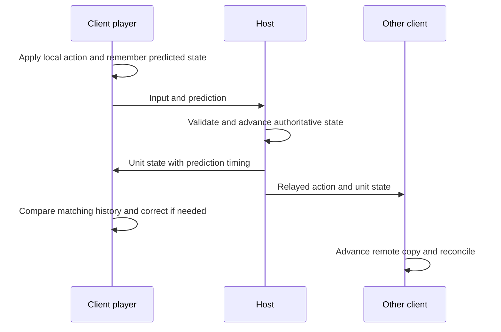

# Following a player action across the network

The example is a client player moving forward while the host and another
player observe them. Read [input](settings_input_and_menus.md) and
[objects](objects_and_gameplay.md) first. The detailed reference is
[NETCODE.md](../../port/linux/NETCODE.md); this chapter supplies a route
through its implementation rather than reproducing its protocol catalogue.

## Reading route

| Order | Source and names to find | What to establish |
| --- | --- | --- |
| 1 | [network_game_manager.c](../../source/networking/network_game_manager.c), [network_server_manager.c](../../source/networking/network_server_manager.c) | Session/player admission and teardown. |
| 2 | [network_distributed.h](../../port/linux/game/network_distributed.h) | Message kinds and shared contracts between the distributed modules. |
| 3 | [network_distributed.c](../../port/linux/game/network_distributed.c): `network_distributed_tick`, `distributed_client_send_inputs`, `distributed_client_send_predictions` | What the client sends after advancing its player. |
| 4 | The same file: `distributed_take_prediction`, `distributed_correct_own_unit`, `network_distributed_handle_message` | Validation, host acceptance and local correction. |
| 5 | [network_objects.c](../../port/linux/game/network_objects.c), [network_damage.c](../../port/linux/game/network_damage.c) | Object lifetime, inventories, damage and hit reports. |
| 6 | [mcc_protocol.c](../../port/linux/game/mcc_protocol.c), [mcc_protocol.h](../../port/linux/game/mcc_protocol.h) | GulchCE's separate MCC admission boundary. |

## Joining creates a session, not just a socket

A listing or advertisement tells a client about a game. Admission still
checks compatibility, available slots and session state. The networking
managers handle players joining and leaving; a player must acquire a
consistent identity before other packets can safely refer to them.

Joining a running game adds further work: load the map, establish the
host's time, receive existing objects and game state, and become ready.
The [joining reference](../../port/linux/NETCODE.md#joining-a-game-in-progress)
explains the sequence and timeout rules. A connected peer that has not
loaded is not yet able to consume all ordinary gameplay messages.

When diagnosing a join failure, separate discovery, admission, content
matching, loading and synchronization. Reaching one of these stages does
not establish that the next succeeded.

## Input and predicted position are different messages

The client's [input path](settings_input_and_menus.md) produces its player's
action. It advances its own player promptly instead of waiting for a round
trip. In `network_distributed_tick`, the client records its own positions,
sends inputs and sends predictions, then performs other client network work.

The input says what the player attempted. The prediction says where the
client's simulation put them. The host does not grant authority simply
because it receives a plausible-looking position: `distributed_take_prediction`
checks movement against its own state and permitted tolerances. The host
applies accepted predictions at its tick boundary. It also relays the
players' actions and sends authoritative unit state to clients.

This diagram describes dependencies, not a promise that every message
arrives or is sent to every peer at the same rate. Distance, visibility,
batching and message type affect transmission frequency.

A client with a custom firing position, such as a VR hand, can send OpenCE's
optional fire-origin message. In `network_damage_handle_fire_origins`, the host
accepts positions only for players owned by that client and within a bounded
reach. The hit-report path checks freshness, hand position and line of sight;
`network.fire_origins` controls whether this can admit a hit the eye cannot see.
MCC's separate message numbers and admission revision are recorded in
[NETCODE.md](../../port/linux/NETCODE.md), preserving OpenCE's message 93.

Co-op presentation has its own authority path. In
[network_coop.c](../../port/linux/game/network_coop.c),
`client_presentation_apply` gives the host's scripted cutscene camera
precedence over dead-player spectating, including vehicle insertion scenes.
`camera_object_offset` follows the client's local copy of the filmed object.
When scripts release the camera, the normal spectating path applies again;
`coop_spectate_nothing_to_watch` retains the host view when nobody is alive
to watch. This is source behavior, not evidence of every campaign cutscene
having been played through.

## Compare states from the same time

Suppose the host replies about tick T, but the client has already moved on.
Comparing the host's old position directly with the client's current
position would mistake legitimate later movement for an error.

`distributed_correct_own_unit` looks up the recorded local position for
the prediction time, checks both time and unit identity, and measures the
host's difference from that historical position. When correction is needed,
it applies the difference to the current position and adjusts the stored
history accordingly. This path preserves movement performed since T; it
is not a general rewind-and-replay implementation of every game object.

The code contains special cases that carry meaning. A co-op player should
not be moved into a BSP the client has not loaded. A player still supported
by the same elevator can have a small vertical phase difference without
having made an invalid jump. Read those guards before simplifying the
position comparison.

## Authority also governs hits and object lifetime

Movement prediction does not give the client authority over kills or
pickups. `network_damage.c` reports a local player's hits and checks them
on the host against ownership, weapon/rate rules, target history and other
constraints. The host deals damage. Clients replay the corresponding
presentation, with special handling for deaths and authoritative state.

A projectile may remain after its firing object is deleted. The player lookup
`get_player_index_from_object_or_parents` in
[damage.c](../../source/objects/damage.c) therefore uses a checked object lookup
before following a non-unit's parent. An expired datum (including a slot reused
by a different object) yields no player for the gametype multiplier lookup.
It does not erase the damage payload's separate player/team attribution or
change host admission. The [owner lookup tests](../../tools/harness/tests/test_damage_owner_lookup.py)
cover live units, AI, parent chains, deletion and slot reuse.

OpenCE's host also checks a reported point hit against level geometry in
`distributed_report_line_of_sight`. For example, a shot reported through
a solid wall is refused if no eligible recent shooter position has a clear
route to the target. The check uses bounded history and trace counts;
vehicle muzzles require a clear segment from the recorded eye position.
`distributed_stuck_detonation` allows a matching host-recorded attached
projectile to detonate after its victim moves behind cover, consuming that
attachment once. Melee, collision and area damage retain their existing
admission checks. The history and attachment ledger reset for each new game.
The [sight tests](../../tools/harness/tests/test_reported_hit_sight.py)
exercise extracted admission functions with controlled collision results,
including deliberate broken variants; they do not simulate every map's
geometry or replace real combat checks.

`network_objects.c` creates, deletes and reconciles replicated objects.
The host tick sends object changes before messages that depend on those
objects. Kill statistics and damage/state ordering matter too: receiving
a reference before the referred-to object or announcing a kill before its
statistics can produce an inconsistent client even if each packet is valid.

An inventory can arrive in an unreliable datagram before its unit or weapons
arrive on the reliable stream, despite the host's send order. OpenCE's
`distributed_client_retry_inventory` retains the latest inventory for each
unit in a bounded queue. `distributed_client_apply_retried_inventories`
checks it each client tick, applies entries once their objects
exist, and expires entries after `EMPTY_INVENTORY_TICKS`. A new game clears
the queue in `network_objects_new_game`. For example, a newly spawned player
can receive their weapon inventory before the weapon object; retaining it
lets the client equip that weapon when it arrives without granting the
client authority over inventory. The
[retry tests](../../tools/harness/tests/test_retried_inventories.py) exercise
late units and weapons, replacement, capacity, forgetting and expiry using
extracted engine functions and deliberate broken variants.

## Transport has its own contracts

Inputs are sent unreliably, with recent button history repeated to tolerate
loss without waiting for retransmission. Important lifecycle events use
reliable connections. Unreliable updates carry time information so stale
data can be rejected. Reliability does not replace size, sender, direction,
rate or index validation.

Internet play uses the P2P transport around this gameplay model. Native
[p2p_webrtc.c](../../port/linux/src/p2p_webrtc.c) and browser
[web_p2p.c](../../port/web/src/web_p2p.c) connect through WebRTC data channels;
the browser's socket constraints change transport implementation, not who
decides damage. See [Transport](../../port/linux/NETCODE.md#transport) before
following packet details into those files.

## GulchCE compatibility and teardown

Xbox/CE crossplay and MCC sessions have separate protocol boundaries.
`mcc_protocol.c` handles capability negotiation, settings sizing and
connection-scoped admission. Its checks supplement ordinary host authority;
a capability claim is not trusted identity. MCC-only gameplay messages must
not execute on Xbox or CE maps. See the
[crossplay boundary](../../port/linux/NETCODE.md#gulchce-crossplay-boundary)
and the current version constants rather than hard-coding a number from
this guide.

OpenCE's dedicated-server update adds a separate advertisement flag and a
client-build report. MCC reserves different values for its capability and
messages, including its pre-admission join envelope. The envelope is checked
before ordinary distributed messages, so sharing its number with the build
report would reject that report before dispatch. `test_mcc_protocol.py`
checks these assignments, dedicated/MCC flag independence, and admission
with the server's player-name filter enabled.

For dedicated hosting, start at [dedicated_server.md](../dedicated_server.md),
then read `server_director.c` for rotation and session ownership and
`server_commands.c` for administration. These are upstream additions; they
do not make an MCC capability claim sufficient to pass normal admission.

`online-third-person` has additional camera-related protocol distinctions.
Read that branch's own NETCODE and protocol headers before assuming that a
visually local feature has no session compatibility consequences. None of
these branch differences changes the basic requirement to clear capability,
player and synchronization state when a connection is removed or reused.

## Evidence and useful checks

The original Xbox lockstep model is replaced by the port's distributed
netcode. The core host/client behaviour above comes from that port; the MCC
admission boundary is GulchCE-specific.
[test_elevator_prediction.py](../../tools/harness/tests/test_elevator_prediction.py)
and [test_elevator_correction.py](../../tools/harness/tests/test_elevator_correction.py)
exercise production movement paths in controlled conditions.
[test_server_teardown.py](../../tools/harness/tests/test_server_teardown.py)
checks session cleanup. These were inspected, not run for this chapter.

[net_compare.py](../../tools/net_compare.py) runs builds together and judges
their logs; [test_net_compare.py](../../tools/test_net_compare.py) tests the
judge itself with constructed logs. Passing the latter does not establish
that two game builds interoperate. Real changes need appropriate host/client,
late-join, loss, teardown and native/browser transport checks. The
[testing chapter](platforms_and_testing.md) explains how to report their limits.

Continue with [maps and resources](maps_and_resources.md), or return to the
[guide](README.md).
