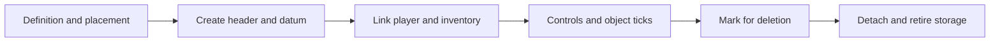

# Players, objects and gameplay state

The example here is a player receiving a new body, controlling it and
eventually losing it. It connects the [input path](settings_input_and_menus.md)
to the [simulation tick](startup_and_loop.md). A player, a unit, a weapon
and a tag definition are related records with different lifetimes.

## Reading route

| Order | Source and names to find | Question it answers |
| --- | --- | --- |
| 1 | [players.h](../../source/game/players.h), [units.h](../../source/units/units.h), [objects.h](../../source/objects/objects.h) | What state belongs to a player, unit or general object? |
| 2 | [players.c](../../source/game/players.c): `player_spawn`, `players_set_local_player_unit`, `players_update_before_game`, `players_update_after_game` | How does a player acquire and control a body? |
| 3 | [objects.c](../../source/objects/objects.c): `object_new`, `objects_update`, `object_delete`, `object_delete_immediately` | How are instances created, advanced and retired? |
| 4 | [data.c](../../source/memory/data.c): `datum_try_and_get`; [object_types.h](../../source/objects/object_types.h) | How do handles and type-specific operations work? |
| 5 | [units.c](../../source/units/units.c): `unit_control`; [weapons.c](../../source/items/weapons.c) | Where do controls and weapon behaviour become gameplay? |
| 6 | [game.c](../../source/game/game.c): `game_tick`; [network_objects.c](../../port/linux/game/network_objects.c) | Who updates objects, and who may create or delete them online? |

## Definitions describe; instances change

A unit definition supplies authored properties, including its camera FOV.
A live unit holds changing state such as health-related flags, position,
inventory and its association with a player. Several instances can use the
same definition without sharing their changing position or damage state.

`player->unit_index` refers to the player's current body. Weapons are
objects too, with their own handles and inventory relationships. The local
player's first-person weapon presentation is another layer: changing its
drawing is not the same operation as changing the weapon's ammunition or
the target's health. The [FOV chapter](field_of_view.md) demonstrates that
separation in a small module.

The engine's object types dispatch different operations for bipeds,
vehicles, weapons and other kinds. When an object-specific function appears
to be missing from `objects_update`, look at the type dispatch it calls
rather than assuming every type is updated inline in that one function.

## Follow a new spawn

`player_spawn` includes a campaign path that can reactivate a retained body.
For this example, follow the path that creates a new unit instead. It finds
a starting location, chooses a unit definition from the appropriate game
globals and constructs `object_placement_data` before calling `object_new`.
The following inventory and player-linking code completes the spawn.

`object_new` does more than allocate a structure. It can apply gametype
definition remapping, validates the tag's object type against the type it
will instantiate, allocates an object header and a type-sized datum, and
initializes position, orientation, ownership, animation and child links.
It starts with a result of `NONE`; callers must account for failure.

This explains two otherwise surprising details. First, a definition index
is not an object index: the new object points back to its definition.
Second, the object header and the object's payload are distinct; the header
tracks identity, type and lifecycle flags used by the object manager.

In a running tick, `players_update_before_game` translates the player's
action into unit controls. `objects_update` visits active objects and calls
their update path, with creation flags and other conditions controlling
eligibility. `players_update_after_game` runs later in `game_tick`.
The order lets the tick coordinate player decisions and object results.

## A handle is not a pointer or a permanent identity

`datum_try_and_get` separates the encoded slot and identifier, checks the
slot against the pool's capacity and checks the entry's identifier. That
extra identifier helps distinguish a later use of a recycled slot from
the object an old handle originally named. There are special cases in the
lookup implementation, so use the engine's accessors rather than inventing
a universal bit manipulation rule at a call site.

An object index cannot be substituted for a player index just because both
are stored in a `long`. Likewise, an array of local-player values cannot
be indexed by either handle. The compiler sees similar integer types; the
program's contracts give them different meanings.

Pointers returned by lookups refer to engine-owned storage. They are not
permission to free that storage, and retaining one across deletion or map
unload can outlive its referent. When following a long-lived field, look
for its clearing or invalidation path as carefully as its assignment.

## Deletion is a lifecycle, not just a free

`object_delete` first checks `network_objects_may_delete`. Its initial
recursive deletion path marks the object and children as being deleted,
hides them and removes names. That is different from concluding that all
storage was freed immediately. The final removal path has attachments,
relationships and type-specific cleanup to handle.

This is why an old projectile's damage-owner record matters even after its
player has left. A reused player slot must not accidentally inherit credit
or authority for that projectile. The production paths exercised by
[test_stale_player_damage.py](../../tools/harness/tests/test_stale_player_damage.py)
retire player references and validate late damage ownership. Its `reused`,
`deleted`, `unspawned` and `authority` cases are useful examples of testing
lifetime rather than only a successful hit.

## Gameplay authority and feature boundaries

The host decides network spawns, pickups, damage and deletion. A client
may predict its own movement while still needing the host's object changes.
Do not infer ownership from a local object being present. Read the checks
in `network_objects.c` and the [network walkthrough](networking.md).

The engine supplies the core object, unit and weapon systems. Port gametypes
and networking add guarded integration. GulchCE's MCC inventory, movement,
damage and object-name adaptations live in the MCC modules listed in
[CODINGSTANDARDS.md](../../CODINGSTANDARDS.md). Similar-looking structures
do not make those compatibility paths interchangeable with Xbox or CE paths.

This chapter traces source; it does not establish gameplay correctness for
every weapon or spawn mode. The stale-damage harness and
[Stagekit walk scenario](../../tools/stagekit/tests/test_walk.py) illustrate
different levels of evidence and were not run for this documentation pass.
A lifecycle change needs failed creation, death, respawn, departure, reused
slots and map teardown checked alongside an ordinary living player.

Continue with [rendering](rendering.md), or return to the [guide](README.md).
