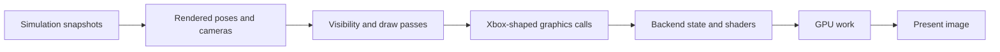

# From game state to a picture

This chapter follows a view of a room containing a moving player and a
weapon. The simulation has already established their state. Rendering
chooses a pose to show, decides what may be visible, submits drawing work
and presents an image. Read [startup and the loop](startup_and_loop.md)
and the [FOV walkthrough](field_of_view.md) for the timing and camera inputs.

## Reading route

| Order | Source and names to find | What it contributes |
| --- | --- | --- |
| 1 | [main.c](../../source/main/main.c): `main_game_render`, `set_window_camera_values` | The views and cameras for this frame. |
| 2 | [render_interpolation.c](../../port/linux/game/render_interpolation.c) | Poses between simulation snapshots and handling of discontinuities. |
| 3 | [render.c](../../source/render/render.c): `render_frame`, `render_player_frame`, `render_window` | Per-frame and per-view ordering. |
| 4 | [render_cameras.c](../../source/render/render_cameras.c): `render_camera_build_frustum`; [render_objects.c](../../source/render/render_objects.c) | Projection, viewing volume and visible objects. |
| 5 | [rasterizer_lights.c](../../source/rasterizer/rasterizer_lights.c), [rasterizer_transparent_geometry.c](../../source/rasterizer/rasterizer_transparent_geometry.c) | Lighting and transparency passes. |
| 6 | [d3d8_gl.c](../../port/linux/src/d3d8_gl.c): `draw_flush`, `D3DDevice_DrawIndexedVertices`, `D3DDevice_Present` | Translating the game's graphics calls to OpenGL and presenting them. |
| 7 | [nv2a_vsh.c](../../port/linux/src/nv2a_vsh.c), [nv2a_psh.c](../../port/linux/src/nv2a_psh.c) | Translation of Xbox shader operations into GLSL. |

## Prepare a view before drawing objects

The engine can render several local players. `render_frame` manages the
frame and windows; `render_player_frame` prepares a player's frustums and
handles additional views such as mirrors. `render_window` performs drawing
within a prepared view. A "window" here can mean one rendered view inside
the application's window, not necessarily a separate operating-system window.

The render camera describes position, orientation, clipping distances and
FOV. Building its frustum produces the planes and transforms used to relate
world positions to the screen. Visibility also uses the map's spatial
structure and potentially visible sets. A later GPU occlusion query is a
different mechanism; the words "visibility" and "culling" can refer to
several stages, so find which stage owns a result before changing it.

In the example, the moving player's rendered pose can lie between its two
simulation snapshots. A teleport or respawn should not interpolate through
all intervening space. `render_interpolation.c` contains the checks and
fallbacks for those discontinuities. Rendered poses and simulation positions
are related values with different purposes.

OpenCE also advances visual function values into the picture's time. Read
`object_function_values_for_render` in [objects.c](../../source/objects/objects.c):
for example, a charging plasma weapon's displayed intensity changes between
ticks without overwriting the simulation's values. `render_object_list` and
`first_person_weapon_draw` retain these values in frame memory because queued
transparent draws can read them later. GulchCE's
[viewmodel shield module](../../port/linux/game/viewmodel_shield.c) copies the
interpolated unit values into its existing per-player arms storage; the shield
and overshield modules still own their feature state and activation checks.

The render functions use the incoming values saved by
`object_compute_function_values`, rather than reading the object's current
inputs. An invisible vehicle weapon can overwrite its parent's inputs after
the parent ticks; rereading those inputs made Warthog headlights follow the
gun's illumination with Smooth Motion enabled. The saved inputs live outside
game state and are checked against the full object handle. Map starts and
saved-game loads call `object_function_inputs_forget` in the lifecycle of
[game_state.c](../../source/saved%20games/game_state.c). Until fresh inputs
exist, or with Smooth Motion disabled, rendering uses the stored tick outputs.
This shared rendering correction preserves the simulation and the separate
Xbox, Custom Edition and MCC loading paths. The asset-free
[picture-function tests](../../tools/harness/tests/test_picture_function_inputs.py)
cover overwritten inputs, additive functions, reused handles and invalidation;
they do not establish GPU visibility or lens-flare occlusion correctness.

## Draw passes have an order and temporary state

Read `render_window` for the actual order of world/object drawing, lighting,
decals, transparent geometry and other effects. Transparent work is not
simply appended to one universal opaque draw: the engine has multiple
passes and queues. Near the end of the primary view, tone mapping and
anti-aliasing happen before interface and menu drawing. This placement
explains why changing a world postprocess need not alter text in the same way.

The first-person weapon can temporarily use a separate projection. Its
begin/end scope must restore the world camera, as the FOV chapter explains.
The same reading habit applies to a texture unit, render target or stencil
state: identify who sets it, which draws use it and who restores it.

Object shadows have the same begin/end contract. In
[rasterizer_xbox_shadows.c](../../source/rasterizer/xbox/rasterizer_xbox_shadows.c),
`_rasterizer_environment_shadow_begin` initializes the shadow volume only
for the primary render target with environment shadows enabled. It returns
false for a skipped pass, so `render_object` in
[render_objects.c](../../source/render/render_objects.c) does not draw or end
an uninitialized volume. This fixes inherited behavior that returned true
even for a skipped pass. Monaco exposed it in a secondary reflection view,
with `structure_clusters_in_sphere` rejecting the uninitialized radius.
The correction applies to all map families and does not alter MCC conversion
or enable shadows in reflections. [test_shadow_setup.py](../../tools/test_shadow_setup.py)
exercises the real setup function for primary and secondary targets, disabled
shadows and transitions back to an enabled primary pass.

## Player shield appearances

GulchCE's non-default SHIELD LOOK presets are restricted to player bipeds.
Read `shield_look_player`, `shield_look_for_unit` and `shield_look_skip_shell`
in [shield_look.c](../../port/linux/game/shield_look.c). The unit's current
player index establishes eligibility, including remote players; an asset
name or shared model does not. For example, an AI Elite sharing a player's
biped definition keeps its authored shield even after the player's preset
has populated the shader cache.

The shared [model submission](../../source/models/models.c) passes object
identity and the first-person flag to shell suppression. First-person hands
use the weapon as their draw identity, so the feature checks its parent
unit without changing the renderer's identity. The same ownership guard
protects depleted arcs and recharge; Arm Shields still controls the added
first-person pass. These are drawing decisions and do not change shield
strength or network state. See [Shield Look](../shield_look.md) for detailed
behaviour and [its regression tests](../../tools/test_shield_look.py) for
shared-model and ownership-transition coverage.

## The platform layer translates graphics state

In the shared OpenGL path, the game still makes Xbox Direct3D 8 calls.
`d3d8_gl.c` reads the device state and translates it into OpenGL operations.
The shader translators convert vertex-program instructions and pixel
combiner state to GLSL. This is why an unfamiliar Xbox-era shader constant
may be consumed several files away from the draw call that sets it.

Coordinate conventions matter: depth range, viewport origin, texture rows
and the final presentation flip must agree. The opening comment in
`d3d8_gl.c` explains the desktop convention; `HALO_GLES` selects the
OpenGL ES/WebGL adaptations. Do not assume a desktop GL facility is available
on Android or the web because the C file is shared.

`fragment_shader_get` first caches the complete pixel-shader state key, so a
repeat draw does not translate GLSL again. GulchCE's `fragment_source_get`
then reuses a compiled fragment shader only when the generated source matches
byte for byte. A hash narrows the search; `strcmp` decides equality. For
example, two different state keys that emit identical GLSL keep separate key
entries but reference one compiled shader. `program_get` can consequently reuse
the same link when the vertex shader also matches. Uniform updates still run
through the existing per-program serial/state checks.

The source cache owns one generated string and shader result per distinct
source, including a failed compile result. Full-key entries borrow the shader
ID. If a source-entry allocation fails, the full-key cache retains its compiled
result without sharing. These entries have the existing device/context lifetime
and retain no map pointers; they are not freed during map transitions. This
does not add context recreation to the backend. See the
[cache tests](../../tools/harness/tests/test_fragment_source_cache.py) and
[fix report](../damage_and_shader_cache_fixes.md) for validation and limits.
Shader generation, AMD's direct visibility readback and the asynchronous
buffered readback used by NVIDIA remain unchanged.

When a new shared fragment is compiled, `fragment_source_get` also calls
`shader_hash_set` before taking ownership of its source. This registers it with
OpenCE's separate on-disk program cache. Reused fragments keep the same shader
ID and source hash, so source deduplication does not disable binary-program reuse.

At presentation, `D3DDevice_Present` unbinds the OpenGL read framebuffer
before `platform_video_swap`. The read framebuffer selects the image used
by pixel-read and copy operations; binding zero selects the default window
framebuffer. This OpenCE change restores the binding expected by OBS game
capture. It applies to the shared GL presentation path; an ordinary render
smoke test alone does not verify OBS capture itself.

Submitting a draw does not mean the GPU has completed it. In particular,
visibility-query results and reusable upload storage have completion rules.
[Visibility query readback](../visibility_queries.md) and
[test_visibility_readback.py](../../tools/harness/tests/test_visibility_readback.py)
show why a delayed GPU result must not be treated as a zero or why asking
for a result too soon can stall the frame. The test uses fake driver
behaviour; it does not measure real GPU performance.

## Dynamic lighting 1.0

Android builds exclude the optional lighting modules and their model-shader
additions. Read the [Android lighting boundary](../../port/android/README.md#lighting-availability)
and [stock hook implementations](../../port/android/guest/dynamic_lighting_disabled.c)
for that fallback. Desktop and web keep the implementation described below;
all optional lighting settings still default off.

On desktop and web, `prepare_draw` obtains `plasma_model_lighting_mask` only
for instruction-recognized point-light model programs. `draw_program_get`
selects the stock vertex and fragment variants when this mask is zero. A
selected optional light chooses lazy enhanced variants instead; the per-pixel
fragment key includes this distinction. This also honors host-controlled
Shield Glow, because the mask uses the existing effective feature policy.
An enabled setting without a selected light still uses stock model shaders.

The stock variants contain no optional model-light uniforms, samplers or
falloff helpers. They skip optional uniform lookup, sampler initialization
and per-draw bindings. Enhanced compile/link failures have separate fallback
state and cannot disable stock per-pixel lighting. Both variants use the
existing source-deduplication and driver-specific binary caches. Previously
used variants remain cached, so toggling back does not recompile them; the
first use can still incur a compile/link hitch. This separation changes no
AMD/NVIDIA translation workarounds or map-family loading paths.
The [shader isolation harness](../../tools/harness/tests/test_dynamic_shader_isolation.py)
checks lazy caching, repeated switches, independent failure recovery and zero
optional GPU calls for stock draws. The
[translator harness](../../tools/harness/tests/test_plasma_model_shader.py)
checks the real vertex programs and point-light formulas on desktop, web and
Android. These CPU tests do not establish driver performance or visual parity.

These optional features are available on `main` and `testing`. The
[plasma lighting source](../../port/linux/game/plasma_lighting.c)
is a useful second example after FOV. `plasma_lighting_prepare` selects
eligible authored projectile-light attachments and records temporary state;
`plasma_lighting_frame_end` restores it. Window and reset functions delimit
view-specific selection and longer-lived feature state.

For world reflections, read `plasma_specular_begin` and
`plasma_specular_color` in [plasma_falloff.c](../../port/linux/game/plasma_falloff.c).
The inherited specular pass uses a light's scalar brightness and the
surface's reflection colours, discarding the light's hue. A green bolt can
therefore produce a pale, view-dependent highlight beside its green spill.
The enhanced path tints both material reflection colours with the selected
light's normalized hue, preserving the existing brightness and falloff.
The small hooks in `_rasterizer_environment_specular_light_begin` and
`_rasterizer_environment_specular_light_draw` are necessary because those
functions own the material shader constants. Policy and temporary tint state
remain in the feature module. Every begin resets the tint, and
`plasma_falloff_end` clears it even when no attenuation texture was bound.
Unselected lights return the original packed material colour unchanged.
Authored no-specular flags, impacts and explosions remain authoritative.
This is a reflection colour correction, not an additional light or a change
to projectile simulation. A highlight can still move relative to diffuse
spill as the viewing angle changes.

The projectile's simulation and tag data are not the place to manufacture
the rendering effect. This path uses the rendered attachment pose and
temporarily changes eligible light behaviour. Separate modules own added
rocket lights, muzzle lighting and Covenant emitters. Their activation,
budgets and cleanup must be read in their own modules, not inferred from
the existence of the common plasma setting.

For the Grunt/Hunter fuel-rod flight light, `lights_preprocess_scene` passes a copy of the
evaluated colour through `covenant_lighting_color` in
[covenant_lighting.c](../../port/linux/game/covenant_lighting.c). With Projectile
Lights enabled, the exact projectile/exhaust pair gets less red and blue while
green modulation stays authored. Only the rasterizer submission is adjusted;
the source light still supplies stock flare and simulation colours. See the
[Covenant projectile reference](../covenant_lighting.md) for tag evidence and
map-lifecycle handling.

The [plasma reference](../plasma_lighting.md)
explains falloff and approximate collision-based occlusion; its
[emitter reference](../covenant_emitter_lighting.md)
explains exact tag/marker eligibility and bounded additional lights.
Approximate occlusion is not a complete shadow system. The
[1.0 baseline guide](../dynamic_lighting_release.md) describes current
controls and known limits; the plasma document retains historical milestone
evidence, with its original prototype restrictions explicitly labelled.

The [plasma tests](../../tools/harness/tests/test_plasma_lighting.py)
and related falloff, occlusion and emitter harnesses are evidence about
specific contracts. They do not establish visual quality across all maps.

For the held Needler, read `needler_falloff_factor` and
`ammo_counter_falloff_texture` in
[ammo_counter_falloff.c](../../port/linux/game/ammo_counter_falloff.c), then
`field_texture` in [plasma_occlusion.c](../../port/linux/game/plasma_occlusion.c).
The mask is radial around the needles; only its downward reach is restricted.
The analytical fade and its filtered texture differ near the lower boundary:
linear filtering mixes adjacent samples, and specular lighting uses a larger
volume. The [visibility harness](../../tools/harness/tests/plasma_occlusion.c)
therefore checks interpolated texture values at crouched-player and short-NPC
foot heights as well as the scalar function. The
[visual acceptance record](../dynamic_lighting_acceptance.md) separates the
real captures from those synthetic checks. Muzzle collision blocking is
automatic with muzzle lighting; the separate Light Occlusion toggle controls
projectile and emitter blocking.

The AR display uses `ammo_counter_lighting_screen` and the paired
`ammo_counter_lighting_draw_begin` / `ammo_counter_lighting_draw_end` helpers in
[ammo_counter_lighting.c](../../port/linux/game/ammo_counter_lighting.c).
`_rasterizer_model_draw` calls them around the display draw: first- and third-person
RGB is doubled before fog and the exact output state is then restored. Both
models share the same emissive floor; their separate spill strengths are unchanged.
This narrow shared hook is
needed because a feature-owned point light cannot brighten the screen's own
material or bracket its draw. The setting and exact material identity guard
the change; the [emitter guide](../covenant_emitter_lighting.md) describes the
separate per-view spill gain and map cleanup.

Visibility history is translated and uniformly scaled between fields.
`field_for` prepares sixteen interpolation coordinates per axis, then shares
them across the 4096 cells; the sample weights, accumulation order and fallback
outside the previous field stay unchanged. This reduces repeated arithmetic
without changing ray count, field resolution, refresh policy or fading.
`field_texture` also shares the diffuse/specular upload when their radii are
exactly equal: the attenuation, visibility and directional texels are identical.
Different specular extents continue to use independent textures.

The 1536 rays in each refresh share one synchronous batch in
[plasma_collision.c](../../port/linux/game/plasma_collision.c).
`plasma_collision_begin` accepts only the field's exact scenery/machine flags,
optionally including vehicles. `plasma_collision_depth` uses the existing
structure BSP and collision-model intersection routines, caching cluster
membership, object eligibility/bounds and model instances within that batch.
For example, a Warthog flash still tests the chassis on every ray; it avoids
fetching the same chassis metadata repeatedly. Parent sphere/eligibility tests
still gate children, and siblings remain independent. These are depth-only
queries, so unused material, plane and location results are not constructed.

The cache is bounded at 512 object records and 4096 cluster references. A full
cache, unsupported flags or a malformed leaf uses `collision_test_vector`;
borrowed model pointers are cleared by `plasma_collision_end`. Nothing is reused
across rendered poses, simulation ticks or maps. Disabled lighting never starts
a batch. This changes no shared collision implementation or map-loading path.
The [batch harness](../../tools/harness/tests/test_plasma_collision.py) covers
ownership, traversal and fallback. Test builders' `--verify-traces` mode compares
every depth with the original engine query and times complete batches against
the same pose; its doubled workload is excluded from FPS acceptance.
The [collision and memory follow-up](../dynamic_lighting_tracing.md) records
the measurements, real-engine comparisons and remaining acceptance limits.

For enhanced model draws only, `plasma_occlusion_model_initialize` in
[plasma_occlusion_gl.c](../../port/linux/src/plasma_occlusion_gl.c) resolves
uniform locations while the linked program is current. Its small record belongs
to `program_entry` in the GL backend, so recycled GL names cannot reuse stale
locations. `plasma_occlusion_bind_model` uses those locations and an immutable
linear/clamped sampler on reserved units 6/7. The sampler and white fallback
texture have GL-context lifetime, like the existing shader-program cache;
per-light field textures are still released by `plasma_occlusion_reset`.
These context resources are created only after an enhanced draw needs them;
disabled draws neither create nor bind them. The backend owns variant selection,
shader linking and this feature-owned binding record, which the game module
cannot manage through its light-selection hooks alone.
Xbox, CE and MCC use the same existing feature hooks, with no loader changes.
See the [performance follow-up](../dynamic_lighting_optimisation.md) for
measurements and the limits of GPU timing versus sustained frame pacing.

For focused Windows stall investigation,
[lighting_performance_build.py](../../tools/lighting_performance_build.py)
adds test-only `--stalls` thread CPU and compile/link clocks; `--resources`
counts retained renderer entries. The runner's `--no-captures` removes image
allocation/readback and keeps every measured frame in pacing results.
[The stability report](../dynamic_lighting_stability.md#focused-stall-and-memory-investigation)
separates observed shader warm-up hitches from unresolved memory ownership
and the unreproduced long stalls. These tools restore production sources;
their diagnostic timings are not clean performance acceptance measurements.
The [Windows hitch investigation](../windows_stutter_investigation.md) records
the correction for direct desktop program links and the limits of the CE
and Digsite MCC runtime measurements; shader-link stalls alone do not establish
the reported GulchCE/OpenCE difference.
The [renderer preparation walkthrough](../render_preparation.md) follows the
optional shader recipes and material selection, separate bounded Xbox/CE and
MCC texture preparation, dead alpha-combiner normalization and the draw-local
honeycomb variant. It distinguishes repeat-visit coverage from first-use work
that remains during gameplay, and identifies the GLES no-op boundaries.

The [shield-lighting walkthrough](shield_lighting.md) describes Shield Glow's
integration with the same falloff, specular and visibility services. Its
surface animation remains in `overshield_effect.c`; the host policy still
owns activation, and the light module never changes shield vitality.

## Vulkan branch notes

The optional renderer on `vulkan-renderer` has dedicated state in
[vulkan_game.c](https://github.com/chestahh/GulchCE/blob/vulkan-renderer/port/linux/src/vulkan/vulkan_game.c),
scene resources and submission in
[vulkan_scene.c](https://github.com/chestahh/GulchCE/blob/vulkan-renderer/port/linux/src/vulkan/vulkan_scene.c),
and separate window/presentation ownership. Guarded D3D8 dispatch hooks
route the enabled feature to that implementation. It reuses pure shader
translation interfaces, adapts GLSL bindings and compiles SPIR-V; it does
not need an OpenGL context to render the native scene.

Its completion fences govern reuse of upload, descriptor and query slots.
A busy slot can defer a frame rather than overwrite data the GPU still
uses. Teardown must retire references before map storage is reused. These
are ownership rules, not merely performance choices.

The branch's [renderer reference](https://github.com/chestahh/GulchCE/blob/vulkan-renderer/docs/vulkan_renderer.md)
describes an experimental native scene milestone. OpenGL remains the
default. Full settings and rendering parity are not established; MCC
resources are outside the milestone's supported boundary, and CE requires
separate Vulkan validation. The
[scene tests](https://github.com/chestahh/GulchCE/blob/vulkan-renderer/tools/test_vulkan_scene.py)
cover specific resource and draw contracts. They are not a blanket
compatibility claim for the renderer or every GPU.

## Evidence and next steps

The engine supplies cameras, visibility, draw ordering and Xbox-style
rasterizer calls. OpenCE supplies the shared GL translation and port
features; the two experimental branches add dedicated GulchCE rendering
work. The branch links above intentionally point outside the current
checkout when those files are absent here.

This chapter records source and reference inspection, not new captures,
benchmarks or GPU test runs. To investigate a rendering change, distinguish
wrong simulation state, wrong rendered pose, culling, shader translation
and stale GPU resources. Check a real image as well as relevant tests, and
record the backend, platform, map, settings and view layout.

Continue with [networking](networking.md), or return to the [guide](README.md).
