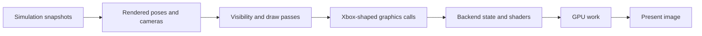

# From game state to a picture

This chapter follows a view of a room containing a moving player and a
weapon. The simulation has already established their state. Rendering
chooses a pose to show, decides what may be visible, submits drawing work
and presents an image. Read [startup and the loop](startup_and_loop.md)
and the [FOV walkthrough](field_of_view.md) for the timing and camera inputs.

## Reading route

| Order | Source and names to find | What it contributes |
| --- | --- | --- |
| 1 | [main.c](../../source/main/main.c): `main_game_render`, `set_window_camera_values` | The views and cameras for this frame. |
| 2 | [render_interpolation.c](../../port/linux/game/render_interpolation.c) | Poses between simulation snapshots and handling of discontinuities. |
| 3 | [render.c](../../source/render/render.c): `render_frame`, `render_player_frame`, `render_window` | Per-frame and per-view ordering. |
| 4 | [render_cameras.c](../../source/render/render_cameras.c): `render_camera_build_frustum`; [render_objects.c](../../source/render/render_objects.c) | Projection, viewing volume and visible objects. |
| 5 | [rasterizer_lights.c](../../source/rasterizer/rasterizer_lights.c), [rasterizer_transparent_geometry.c](../../source/rasterizer/rasterizer_transparent_geometry.c) | Lighting and transparency passes. |
| 6 | [d3d8_gl.c](../../port/linux/src/d3d8_gl.c): `draw_flush`, `D3DDevice_DrawIndexedVertices`, `D3DDevice_Present` | Translating the game's graphics calls to OpenGL and presenting them. |
| 7 | [nv2a_vsh.c](../../port/linux/src/nv2a_vsh.c), [nv2a_psh.c](../../port/linux/src/nv2a_psh.c) | Translation of Xbox shader operations into GLSL. |

## Prepare a view before drawing objects

The engine can render several local players. `render_frame` manages the
frame and windows; `render_player_frame` prepares a player's frustums and
handles additional views such as mirrors. `render_window` performs drawing
within a prepared view. A "window" here can mean one rendered view inside
the application's window, not necessarily a separate operating-system window.

The render camera describes position, orientation, clipping distances and
FOV. Building its frustum produces the planes and transforms used to relate
world positions to the screen. Visibility also uses the map's spatial
structure and potentially visible sets. A later GPU occlusion query is a
different mechanism; the words "visibility" and "culling" can refer to
several stages, so find which stage owns a result before changing it.

In the example, the moving player's rendered pose can lie between its two
simulation snapshots. A teleport or respawn should not interpolate through
all intervening space. `render_interpolation.c` contains the checks and
fallbacks for those discontinuities. Rendered poses and simulation positions
are related values with different purposes.

## Draw passes have an order and temporary state

Read `render_window` for the actual order of world/object drawing, lighting,
decals, transparent geometry and other effects. Transparent work is not
simply appended to one universal opaque draw: the engine has multiple
passes and queues. Near the end of the primary view, tone mapping and
anti-aliasing happen before interface and menu drawing. This placement
explains why changing a world postprocess need not alter text in the same way.

The first-person weapon can temporarily use a separate projection. Its
begin/end scope must restore the world camera, as the FOV chapter explains.
The same reading habit applies to a texture unit, render target or stencil
state: identify who sets it, which draws use it and who restores it.

## The platform layer translates graphics state

In the shared OpenGL path, the game still makes Xbox Direct3D 8 calls.
`d3d8_gl.c` reads the device state and translates it into OpenGL operations.
The shader translators convert vertex-program instructions and pixel
combiner state to GLSL. This is why an unfamiliar Xbox-era shader constant
may be consumed several files away from the draw call that sets it.

Coordinate conventions matter: depth range, viewport origin, texture rows
and the final presentation flip must agree. The opening comment in
`d3d8_gl.c` explains the desktop convention; `HALO_GLES` selects the
OpenGL ES/WebGL adaptations. Do not assume a desktop GL facility is available
on Android or the web because the C file is shared.

At presentation, `D3DDevice_Present` unbinds the OpenGL read framebuffer
before `platform_video_swap`. The read framebuffer selects the image used
by pixel-read and copy operations; binding zero selects the default window
framebuffer. This OpenCE change restores the binding expected by OBS game
capture. It applies to the shared GL presentation path; an ordinary render
smoke test alone does not verify OBS capture itself.

Submitting a draw does not mean the GPU has completed it. In particular,
visibility-query results and reusable upload storage have completion rules.
[Visibility query readback](../visibility_queries.md) and
[test_visibility_readback.py](../../tools/harness/tests/test_visibility_readback.py)
show why a delayed GPU result must not be treated as a zero or why asking
for a result too soon can stall the frame. The test uses fake driver
behaviour; it does not measure real GPU performance.

## Dynamic-lighting branch notes

These features live on `dynamic-lighting-test`. The branch's
[plasma lighting source](https://github.com/chestahh/GulchCE/blob/dynamic-lighting-test/port/linux/game/plasma_lighting.c)
is a useful second example after FOV. `plasma_lighting_prepare` selects
eligible authored projectile-light attachments and records temporary state;
`plasma_lighting_frame_end` restores it. Window and reset functions delimit
view-specific selection and longer-lived feature state.

For world reflections, read `plasma_specular_begin` and
`plasma_specular_color` in [plasma_falloff.c](../../port/linux/game/plasma_falloff.c).
The inherited specular pass uses a light's scalar brightness and the
surface's reflection colours, discarding the light's hue. A green bolt can
therefore produce a pale, view-dependent highlight beside its green spill.
The enhanced path tints both material reflection colours with the selected
light's normalized hue, preserving the existing brightness and falloff.
The small hooks in `_rasterizer_environment_specular_light_begin` and
`_rasterizer_environment_specular_light_draw` are necessary because those
functions own the material shader constants. Policy and temporary tint state
remain in the feature module. Every begin resets the tint, and
`plasma_falloff_end` clears it even when no attenuation texture was bound.
Unselected lights return the original packed material colour unchanged.
Authored no-specular flags, impacts and explosions remain authoritative.
This is a reflection colour correction, not an additional light or a change
to projectile simulation. A highlight can still move relative to diffuse
spill as the viewing angle changes.

The projectile's simulation and tag data are not the place to manufacture
the rendering effect. This path uses the rendered attachment pose and
temporarily changes eligible light behaviour. Separate modules own added
rocket lights, muzzle lighting and Covenant emitters. Their activation,
budgets and cleanup must be read in their own modules, not inferred from
the existence of the common plasma setting.

The branch's [plasma reference](https://github.com/chestahh/GulchCE/blob/dynamic-lighting-test/docs/plasma_lighting.md)
explains falloff and approximate collision-based occlusion; its
[emitter reference](https://github.com/chestahh/GulchCE/blob/dynamic-lighting-test/docs/covenant_emitter_lighting.md)
explains exact tag/marker eligibility and bounded additional lights.
Approximate occlusion is not a complete shadow system. Read the implementation
alongside older milestone notes: the plasma document still names its original
prototype branch, while the combined work is on `dynamic-lighting-test`.

The branch's [plasma tests](https://github.com/chestahh/GulchCE/blob/dynamic-lighting-test/tools/harness/tests/test_plasma_lighting.py)
and related falloff, occlusion and emitter harnesses are evidence about
specific contracts. They do not establish visual quality across all maps.

For the held Needler, read `needler_falloff_factor` and
`ammo_counter_falloff_texture` in
[ammo_counter_falloff.c](../../port/linux/game/ammo_counter_falloff.c), then
`field_texture` in [plasma_occlusion.c](../../port/linux/game/plasma_occlusion.c).
The mask is radial around the needles; only its downward reach is restricted.
The analytical fade and its filtered texture differ near the lower boundary:
linear filtering mixes adjacent samples, and specular lighting uses a larger
volume. The [visibility harness](../../tools/harness/tests/plasma_occlusion.c)
therefore checks interpolated texture values at crouched-player and short-NPC
foot heights as well as the scalar function. The
[visual acceptance record](../dynamic_lighting_acceptance.md) separates the
real captures from those synthetic checks. Muzzle collision blocking is
automatic with muzzle lighting; the separate Light Occlusion toggle controls
projectile and emitter blocking.

The [shield-lighting walkthrough](shield_lighting.md) describes Shield Glow's
integration with the same falloff, specular and visibility services. Its
surface animation remains in `overshield_effect.c`; the host policy still
owns activation, and the light module never changes shield vitality.

## Vulkan branch notes

The optional renderer on `vulkan-renderer` has dedicated state in
[vulkan_game.c](https://github.com/chestahh/GulchCE/blob/vulkan-renderer/port/linux/src/vulkan/vulkan_game.c),
scene resources and submission in
[vulkan_scene.c](https://github.com/chestahh/GulchCE/blob/vulkan-renderer/port/linux/src/vulkan/vulkan_scene.c),
and separate window/presentation ownership. Guarded D3D8 dispatch hooks
route the enabled feature to that implementation. It reuses pure shader
translation interfaces, adapts GLSL bindings and compiles SPIR-V; it does
not need an OpenGL context to render the native scene.

Its completion fences govern reuse of upload, descriptor and query slots.
A busy slot can defer a frame rather than overwrite data the GPU still
uses. Teardown must retire references before map storage is reused. These
are ownership rules, not merely performance choices.

The branch's [renderer reference](https://github.com/chestahh/GulchCE/blob/vulkan-renderer/docs/vulkan_renderer.md)
describes an experimental native scene milestone. OpenGL remains the
default. Full settings and rendering parity are not established; MCC
resources are outside the milestone's supported boundary, and CE requires
separate Vulkan validation. The
[scene tests](https://github.com/chestahh/GulchCE/blob/vulkan-renderer/tools/test_vulkan_scene.py)
cover specific resource and draw contracts. They are not a blanket
compatibility claim for the renderer or every GPU.

## Evidence and next steps

The engine supplies cameras, visibility, draw ordering and Xbox-style
rasterizer calls. OpenCE supplies the shared GL translation and port
features; the two experimental branches add dedicated GulchCE rendering
work. The branch links above intentionally point outside the current
checkout when those files are absent here.

This chapter records source and reference inspection, not new captures,
benchmarks or GPU test runs. To investigate a rendering change, distinguish
wrong simulation state, wrong rendered pose, culling, shader translation
and stale GPU resources. Check a real image as well as relevant tests, and
record the backend, platform, map, settings and view layout.

Continue with [networking](networking.md), or return to the [guide](README.md).
