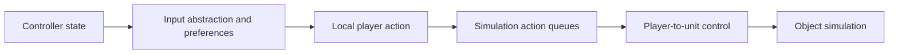

# From a setting or input to an action

This chapter follows two related paths: saving a menu setting, and pushing
a controller stick forward in a local game. The setting path changes a
stored preference; the input path produces an action for the current player.
Read [startup and the loop](startup_and_loop.md) first to place both in time.

## Reading route

| Order | Source and names to find | What to follow |
| --- | --- | --- |
| 1 | [port_config.c](../../port/linux/src/port_config.c): `config_settings`, `config_load`, `config_value`, `config_write`, `config_changes` | Definition, loading, reading and changing a port setting. |
| 2 | [port_settings.py](../../tools/port_settings.py): `SCREENS`; [menu_functions.c](../../port/linux/game/menu_functions.c): `pc_menu_event_function_invoke`, `setting_changed_save`, `setting_write` | Generated choices and their runtime callbacks. |
| 3 | [xinput_sdl.c](../../port/linux/src/xinput_sdl.c): `XInputGetState`, `halo_linux_mouse_look` | Device input presented to the game. |
| 4 | [input_xbox.c](../../source/input/input_xbox.c): `input_update`, `input_frame_begin`; [input_abstraction.c](../../source/input/input_abstraction.c): `input_abstraction_update` | Raw controller state becoming game controls. |
| 5 | [player_control.c](../../source/game/player_control.c): `get_local_player_input_blob`, `player_control_update` | Movement, facing and buttons for a local player. |
| 6 | [players.c](../../source/game/players.c): `players_update_before_game`; [units.c](../../source/units/units.c): `unit_control` | Applying an action to the player's unit. |

## Settings have a definition and consumers

Each port setting has a name, type, default, environment-variable mapping,
platform applicability and explanatory text in `config_settings`. Loading
starts with defaults, reads configuration-file values and applies supported
environment overrides. `config_value` triggers the initial load under a
lock and checks that the requested name and type match a defined setting.

Reading a setting is not the same as applying its effects. For example,
FOV code reads a real value, converts it and retains the converted result
until `config_changes()` advances. Another consumer may need a restart or
an explicit resource reload. Inspect the consumer before assuming a newly
saved value takes effect in the same way everywhere.

The [FOV walkthrough](field_of_view.md) traces a complete example. Its
setting changes memory through `config_write`, attempts persistence in
`config.toml` and advances the change count. A failed file write is not
proof that the in-memory value stayed unchanged. Likewise, editing the
file externally is not evidence that every consumer watches it live.

## Menu data selects a runtime operation

The menu XML describes widgets and event names. It is produced by
[ce_menus.py](../../tools/ce_menus.py) and `port_settings.py`; use the
[menu asset reference](../../port/assets/menus/README.md) for regeneration.
[menu_tags.c](../../port/linux/game/menu_tags.c) connects the port's menu
assets to runtime tags, while `menu_functions.c` implements named callbacks.

For a settings spinner, `setting_changed_save` ignores invalid or unchanged
selections, then passes the chosen text value to `setting_write`. Names
starting with `profile.` take the player-profile path. Other names, such
as `display.fov`, go to `config_write`. This distinction is why controller
preferences and global display settings need not be stored in the same file.

When a button appears to do nothing, trace its event name into
`pc_menu_event_function_invoke` before changing its appearance. The existing
[unwired-function list](../../port/assets/menus/UNWIRED.md) records known
gaps. A visible widget alone does not establish that its action is implemented.

## Follow the forward stick

[Controller button remapping](controller_remapping.md) adds a Gamepad Setup
submenu with independent P1-P4 layouts. It transforms physical button input
before keyboard/touch merging, while leaving menu navigation and stick axes intact.

On the normal controller path, the SDL-backed `XInputGetState` supplies the
Xbox-shaped state consumed by `input_xbox.c`. `input_abstraction_update`
uses the local player's control preferences to translate stick positions
and buttons into `game_input_state`: forward movement, strafe, yaw, pitch
and named controls.

`get_local_player_input_blob` starts with a cleared action and resolves the
local player and device. Among its operations, it copies
`input_state->forward_movement` and `input_state->strafe` into the action's
throttle. It handles look rates and control conditions as well. The
player-control and update-queue machinery then supplies actions to the
simulation; `players_update_before_game` prepares `unit_control_data` and
calls `unit_control` for the player's unit when control is allowed.

The stick does not directly assign a world position. Unit and object logic
interpret the control using movement rules, collision and current state.
A player with no unit, a paused menu, an inhibited control state or a network
role can change which parts of this route are active.

## Keyboard, mouse and text have distinct routes

The opening comment in `xinput_sdl.c` is particularly useful. During
gameplay, keyboard bindings produce named actions rather than pretending
to press all the controller buttons. During menus, navigation keys do map
to controller-like navigation. Mouse aim supplies accumulated motion through
`halo_linux_mouse_look` instead of becoming a right-stick turning rate.

That mouse function consumes pending motion and clears it under a lock.
This is a small ownership example: reading a delta may consume it, whereas
reading a held button is a state query. Calling the former twice can have
different results even within one frame.

Console input, chat text, menu text boxes and gameplay bindings also have
different capture rules. Investigating "Escape did the wrong thing" starts
with the active input context. It does not start with globally changing the
key's meaning. Split-screen controller indices and local-player indices
must remain associated with the intended player.

## MCC pause menus

MCC uses its own pause widgets so an authored map cannot replace the native
pause actions. Read [mcc_pause.c](../../port/linux/game/mcc_pause.c), starting
with `mcc_pause_screen`, `mcc_pause_dialog` and `mcc_pause_key`. Their Xbox
reference layouts include OpenCE's Settings and co-op Friendly Fire entries.
For example, Revert opens ATTENTION with B=CANCEL and A=OK; confirmation
reaches `mcc_ui_event_function` in [mcc_ui.c](../../port/linux/game/mcc_ui.c),
which checks host authority and checkpoint validity before reverting.

[mcc_pause_runtime.c](../../port/linux/game/mcc_pause_runtime.c) appends an
owned tag table only after construction succeeds. `mcc_pause_borrow_art`
selects the port's existing panel and alert redraws without modifying their
original groups or textures. The glyphs use embedded small menu-button
redraws, not the MCC map's gameplay icons. Teardown releases MCC allocations
first and leaves borrowed textures for their native owner. Xbox and Custom
Edition retain their existing pause builders and action routes.

The focused checks are [test_mcc_pause.py](../../tools/test_mcc_pause.py),
[test_mcc_pause_runtime.py](../../tools/test_mcc_pause_runtime.py) and
[test_mcc_ui.py](../../tools/test_mcc_ui.py). They cover layout and actions,
failed construction, resource ownership, controller cleanup and client
refusal. Real screenshots and host/client menu interaction are still needed
to verify presentation and navigation. See [MCC pause behavior](../mcc_maps.md#in-game-pause-menus)
for context-specific choices and split-screen limitations.

## Evidence and useful checks

The inherited game provides control abstraction, profiles, widgets and unit
control. The port provides SDL input, keyboard actions, configuration and
generated menu integration. GulchCE features add their own settings and
callbacks within those boundaries.

[test_button_presets.py](../../tools/harness/tests/test_button_presets.py)
extracts the actual profile-to-control mapping and checks layouts, unknown
preset fallback and deliberately faulty variants.
[test_profile_keyboard.py](../../tools/harness/tests/test_profile_keyboard.py)
checks virtual-keyboard input and cleanup when creating a profile. These
tests do not prove that a real device, focus transition or menu layout works
on every platform.
They were inspected, not run, for this chapter.

For an input change, check holding and releasing the control across gameplay,
menus and text entry, then check a second local player. For a setting change,
check default loading, save failure, reload and the actual consumer. Keep
generated XML changes tied to the intended generator change.

Continue with [objects and gameplay](objects_and_gameplay.md), or return to
the [guide](README.md).

For the optional AUTO BUTTON DETECTION setting and independent manual/family
preferences, see [controller detection and button styles](controller_buttons.md).
