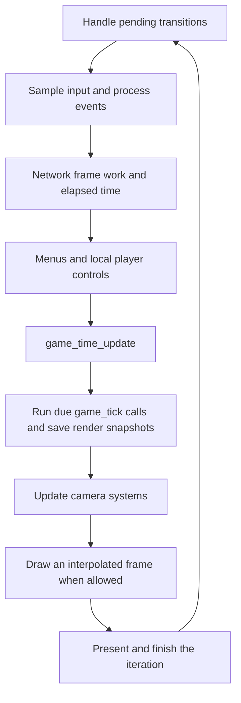

# From launch to a running game

Start here for the order in which the major systems run. The example is
launching a desktop build, reaching the menu and starting a local map.
Networking and platform-specific startup add steps, covered in the
[networking](networking.md) and [platforms and testing](platforms_and_testing.md)
chapters. See the [glossary](glossary.md) for tick, frame and lifecycle.

## Reading route

| Order | Source and names to find | Question it answers |
| --- | --- | --- |
| 1 | [shell_xbox.c](../../source/shell/shell_xbox.c): `main` | Where does the shared game begin? |
| 2 | [shell.c](../../source/shell/shell.c): `shell_initialize`, `shell_dispose` | Which services must exist before the loop? |
| 3 | [main.c](../../source/main/main.c): `main_loop`, `main_change_map_name`, `main_new_map` | How do menu requests become map transitions? |
| 4 | [game.c](../../source/game/game.c): `game_load`, `game_initialize_for_new_map`, `game_tick`, `game_dispose_from_old_map` | What belongs to a game or to one loaded map? |
| 5 | [game_time.c](../../source/game/game_time.c): `game_time_update` | How many simulation steps are due? |
| 6 | [render_interpolation.c](../../port/linux/game/render_interpolation.c): `render_interpolation_tick`, `render_interpolation_frame_begin`, `render_interpolation_frame_end` | How can drawing happen between those steps? |

## Startup establishes the services

The name `shell_xbox.c` reflects the engine's origin. The native port still
uses its game entry point, while the platform layer implements the Xbox
calls it makes. Begin at `main`; some historical helper names near it are
colourful but are not feature names you need to learn first.

The entry point prepares memory, then calls `shell_initialize`. That function
initializes the basic runtime and platform, opens tag-file services, prepares
maths and game-state storage, and initializes the rasterizer. Input and sound
initialization follow a successful rasterizer initialization. The return
value determines whether the entry point proceeds to `main_loop`.

This is a useful ownership distinction: allocating the game's memory and
opening its services does not mean a playable level is loaded. There are
process-lifetime services, per-map state, and per-frame temporary state.
Reading only the startup function would miss the latter two.

## A menu request is handled by the loop

`main_loop` initializes console, debug-key and game systems, sets up the
connection and clock, and requests the main menu. At the top of its loop,
it handles pending operations such as map changes, saves, reverts, respawns
and returns to the menu. These flags let an action request a transition
without doing all its work on the caller's stack.

For the local example, `main_change_map_name` handles the menu fade and
constructs `game_options` with a map name and difficulty. Its local path
disposes the old map's game systems, precaches the requested map, unloads
the old scenario and calls `main_new_map`. That function flushes input,
calls `game_load`, initializes the new map on success, creates local
players and starts game time when errors permit. It also resets pending
transition flags. Follow [maps and resources](maps_and_resources.md) for
what `game_load` does with the map name.

The main menu itself is a scenario with a rendered scene. Consequently,
"a scenario is loaded" and "the player is in a playable match" are different
conditions. Guards such as `game_in_progress`, `game_engine_running` and
`main_menu_is_loaded` should be read at the call site rather than treated
as synonyms. Here, `game_engine_running` refers to the gametype machinery,
not simply to the application running.

## A frame can contain zero, one or several ticks

The following is a simplified dependency order for an active iteration;
pause state, connection type and pending transitions select different paths.

`game_time_update` adds elapsed seconds to leftover time, converts that
total into whole ticks at the current game speed, and retains the fraction.
It also bounds catch-up work and accounts for connection state. When a tick
is permitted, it calls `game_tick` and then `render_interpolation_tick`.

For intuition, a display at 120 frames per second has roughly four frame
intervals per normal 30 Hz tick. That is not a promise that every fourth
iteration ticks: timing, loading, pauses and speed changes affect scheduling.
The important consequence is that a frame with no tick must report no new
simulation time. `last_local_time_elapsed` is cleared before the calculation
so HUD timers and similar frame-side consumers do not reuse the last tick's
elapsed count repeatedly.

## What a tick advances

Read `game_tick` as an ordered list of responsibilities. It updates units,
AI or host-driven actors, players before gameplay, effects, first-person
weapons, the gametype, scripts where allowed, objects, players after
gameplay, and HUD/player effects. The exact ordering is executable code;
the list here is a route through it, not permission to reorder systems.

Only the host runs AI for a distributed game. In network co-op, clients
also skip the host's script execution. Those conditions explain why a
function that exists in every build is not necessarily executed by every
machine. The [gameplay](objects_and_gameplay.md) chapter follows a player's
unit through this machinery.

Drawing is separately bracketed by `render_interpolation_frame_begin` and
`render_interpolation_frame_end`. The interpolation module keeps tick
snapshots and blends poses for drawing, with discontinuity handling for
teleports, respawns and camera cuts. Its opening comment explains the
normal one-tick presentation delay. Camera responsiveness features should
be read separately from the simulation clock.

## Lifetime and evidence

The inherited engine supplies the shell, scenario lifecycle, game loop and
tick structure. The port adds interpolation, platform scheduling, network
work and guarded feature integration. GulchCE's MCC speed handling appears
in `game_time_update`; it is an explicit boundary, not a reason to treat all
maps as MCC maps.

On the web, `main_loop_web_frame` calls `main_loop_iteration` through
Emscripten. On native builds, preprocessor branches retain the loop inside
`main_loop`. A search result for `main_loop_iteration` alone therefore does
not describe every build's call stack.

This chapter is based on source inspection. The
[Stagekit walk tests](../../tools/stagekit/tests/test_walk.py) demonstrate
how the real engine's movement can be checked on generated data, while the
[Stagekit reference](../../tools/stagekit/README.md) explains deterministic
replays and their limits. They are not tests of every startup failure or
menu transition, and were not run for this documentation change. For a loop
change, investigate pauses, no-tick frames, catch-up, map transitions and
web callbacks as well as ordinary gameplay.

Continue with [settings, input and menus](settings_input_and_menus.md), or
return to the [guide](README.md).
